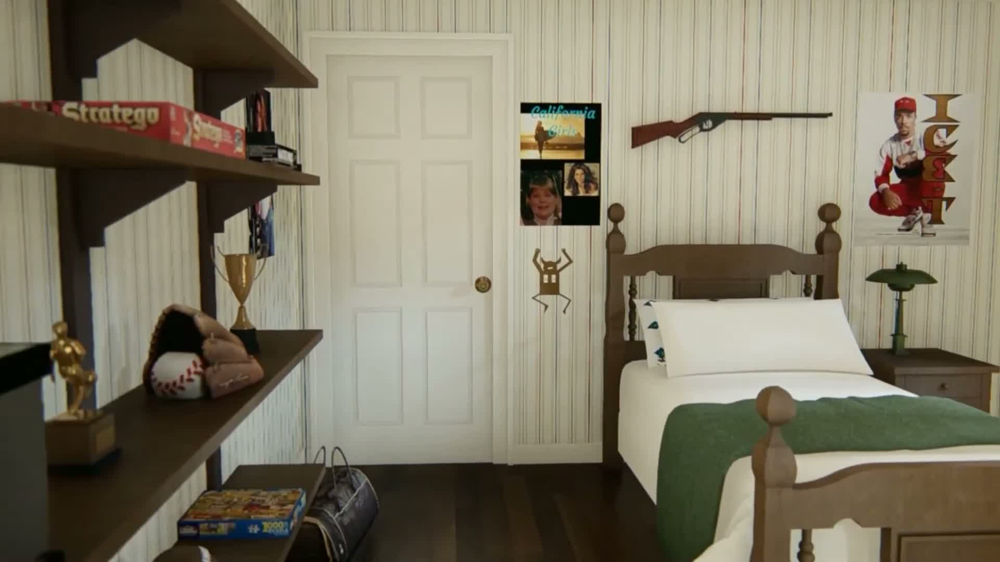

> September 18: [Walkable candidate built and tested](WALKTHROUGH.md). This is a practical estimated blockout, not a promotion of the rejected camera-depth fit. Unity is left in Play mode in BuzzWalkableCandidate.unity.

> September 15: **Depth gate FAILED.** The earlier 5–8px result applies only to wall-adjacent headposts. The nearer footpost fails. Current Unity scene remains a composition study, not a validated room reconstruction.

# Buzz room — first-principles proportion experiment

Status: joint bed-wall candidate now built; see latest result below. Historical initial estimates follow. Separate Unity study built; wall-plane method demonstrated. **Whole-room reconstruction is not yet validated.** Main walkthrough and hallway unchanged.

## Evidence and priorities

- [Marina Part 2, 9:16–9:20](https://www.youtube.com/watch?v=kU7aY1anpAI&t=556s): primary design evidence, weight **5/5** for reproducing this CG layout; not surveyed dimensions. Local frames: [556](../buzz-bedroom/tour556.jpg), [558](tour558.jpg), [560](../buzz-bedroom/tour560.jpg).
- [Marina overhead, 0:50](../buzz-bedroom/overhead50.jpg): room adjacency evidence, weight **5/5**; perspective needs correction before footprint measurements. Not yet fitted in this experiment.
- Existing Unity room: comparison baseline only, weight **0/5** for target dimensions.
- Door width/height assumption: weight **1/5**. Tested 0.38, 0.42, 0.46; door height defined as one unit. No assumption that this door actually measures 80 inches.

## Result

| Quantity | Central estimate, door height = 1 | Status |
|---|---:|---|
| Bed-wall span | 1.842 | Inferred, approximate wall corners |
| Door width | 0.420 | Assumed |
| Door right edge to apparent left headpost | 0.315 | Wall-plane estimate |
| Apparent headpost spacing | 0.553 | Depth/parallax unresolved |
| Wall span / apparent headpost spacing | 3.33 | Useful relative composition |
| Room depth | 2.10 | Placeholder |
| Ceiling height | 1.18 | Placeholder |
| Bed length | 0.98 | Placeholder |

Door-aspect sensitivity gives wall span 1.67–2.02 units. This is an assumption range, **not a confidence interval**. The current house has roughly 2.82 full-headboard widths across this wall; comparison is indicative because full bounds and post centres are different landmarks. It does not establish a physical widening amount.

## Method and verification

`python3 art/home_alone/references/buzz-poc/fit.py` rectifies the door plane, transfers upper-wall features between three frames using SIFT/RANSAC, and writes all coordinates, feature matches and results to `fit-results.json`. The synthetic coordinate-transform regression passes. Separately read door corners at 9:20 agree within about 0.010 door-height units RMS. That frame participates in feature alignment, so this is a held-out landmark check, not a fully withheld camera test.

The reference-camera door fit is 2.56 pixels per-coordinate RMS at 1920×1080 with an assumed 60-degree vertical field of view. This checks the door only. Headboard geometry sits forward of the plane and visibly differs from the reference; it has not passed a furniture reprojection check. Wall corners are manually located and partly extrapolated beyond the feature-match region. Those uncertainties are not quantified yet.

## Review in Unity

Open `Assets/Scenes/BuzzProportionPOC.unity`. This is a static neutral blockout in door-height units, not a walkable replacement bedroom. The saved camera faces the bed wall. Rebuild using `HomeAlone > Marina PoC > Build Buzz study`.

[Unity bed-wall comparison](../../../../unity/HomeAlone/Assets/Captures/BuzzPOC/bed-wall.png)

## Remaining gate before extending to other rooms

1. Fit the overhead and opposite-wall views to recover room depth and furniture footprints.
2. Resolve headboard depth and match the same post landmarks in Unity and Marina.
3. Validate a genuinely withheld view and report landmark residuals.
4. Choose world scale explicitly, check traversal/headroom, then reconcile with the fixed hallway silhouette.

No house-wide changes or decoration pass until these gates pass. The overhead Unity capture currently has a rendering issue and is not evidence of a validated footprint.

## Overhead / opposite-wall continuation

[Annotated reference comparison](review.html) records the new landmarks. `overhead_fit.py` maps the wall-top quadrilateral to a unit square. Its synthetic corner check passes. Moving the four corners by up to 3 pixels changes the sampled normalized landmarks by at most 0.019; this measures picking sensitivity only, not parallax or camera uncertainty.

The apparent bed span occupies about **41% of room depth** in this mapping. Because the bed and wall tops are at different heights, this does not establish a metric room depth. The PoC currently uses 0.98 / 2.10 = 47%; that discrepancy is now explicit, rather than concealed by another arbitrary room resize. A calibrated camera and bed height are needed to distinguish projection error from room depth error.

The 9:10 dresser view and 9:05 corner view establish **two windows on the dresser wall plus one on the adjoining desk wall**. Added the missing third window marker to the separate scene. Heights and widths remain placeholders. These views do not show enough shared floor corners to validate the complete room volume.

Source classification correction: `overhead54.jpg` and `overhead60.jpg` are production/set photographs embedded in the video, not additional camera views of Marina's CG model. They must not be merged into a single CG camera solve.

## Joint camera and rigid-headboard result

Three camera poses, a shared focal length, door aspect, and a rigid horizontal headpost pair were fitted together against 9:16, 9:18 and 9:20. Door corners in these fits come from the earlier wall homographies; therefore the low residual is conditional on that earlier model, not independent measurement accuracy. Three initial guesses converged to the same candidate: about 39.3° vertical FOV, 0.410 door aspect, 0.540 headpost spacing, 1.797 wall width (door height = 1). Joint landmark residual is 0.58px per coordinate.

**Genuinely new frame:** [9:19](tour559.jpg) was excluded from the geometry fit. Fitting only its camera pose from manually picked door corners predicts withheld headpost centres within **4.64px and 8.31px** at 1920×1080. This supports the bed-wall composition. It does not validate room depth, shelves, or windows.

**Depth limitation:** the fitted headboard depth reaches the zero-distance bound at the wall. It is not a credible measurement of physical headboard thickness or stand-off. The useful result is its projected horizontal placement. Camera calibration remains conditional on the landmarks and rigid-model assumptions. The earlier independent camera sweep is retained in `parallax-results.json` to show the sensitivity of unconstrained estimates.

Updated isolated Unity scene and [captured joint candidate](../../../../unity/HomeAlone/Assets/Captures/BuzzPOC/bed-wall-joint.png); main house checksum unchanged. The grayscale furniture is still placeholder geometry, not a final furnished room.

Reproduce sequentially: `fit.py`, `rigid_fit.py`, `apply_joint.py`, then Unity menu Build Buzz study. `apply_joint.py` asserts the withheld headpost error stays below 10px. `parallax_check.py` also includes a synthetic stereo recovery assertion. `study-planar.json` preserves the initial candidate.

## September 15 — cross-depth rejection

`foot_fit.py` triangulated the same nearer footpost from 556/560 using the previous camera solution, with no forced alignment to the headboard. A synthetic point recovery check passes. The fitted footpost has a 15.35px per-coordinate residual and misses withheld 559 by 58.54px.

`volume_fit.py` jointly refitted the cameras with the footpost included. Three initial guesses converge and fitting RMS is only 0.60px, yet the withheld footpost error is **91.63px** (door-only pose). Including the known headposts in the withheld camera pose still leaves about 89px footpost error. Thus low training residual and repeated convergence are insufficient. No candidate bed length or room depth has been applied.

Possible causes still to distinguish: unstable planar camera calibration, incorrect shared-point annotation, or varying projection across the tour. These are hypotheses, not established explanations. The 39-degree FOV is not verified. The joint fit's approximately 1.15-door-height bed length is a rejected candidate, not a measurement.

Next experiment: dense matches over a longer continuous CG segment, separating walls from nearer furniture; test shared versus variable intrinsics and validate nearer features withheld from fitting. Keep source snapshots and existing house unchanged.
