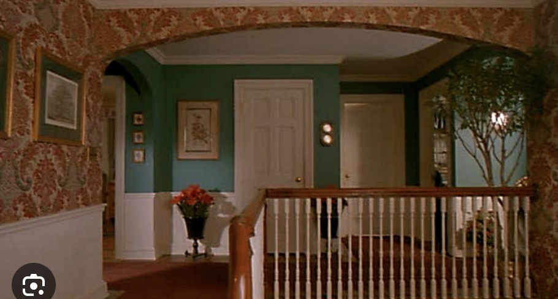

# Local upstairs opening study

## Multi-view decision — September 13 follow-up

**HOLD the candidate; retain the working geometry.** The additional views do not independently verify X2.000 or a 0.689m floor extension. The earlier recommendation to advance it meant test it, not adopt it. Foyer structural review remains open.

| Inspected source | What it supports | What it cannot establish | Weight for this question |
| --- | --- | --- | --- |
| [Ground overhead](../../reconciliation/first-floor-user-shots/06-ground-overhead.png) | Rear landing spans the stair/passage zone beside breakfast room | Upper gallery is removed; its side edge cannot be measured | 3 topology, 0 missing edge |
| [Upper overhead](../../reconciliation/first-floor-user-shots/07-upper-overhead.png) | Hall/closet/bath/bedroom adjacency | Stairwell is omitted; black background is not an opening boundary | 3 topology, 0 missing edge |
| [Upper isometric](../../reconciliation/first-floor-user-shots/08-upper-isometric.png) | Hall beside linen closet/bath and guarded stair opening | Partial railing and occlusion do not locate the entire opening | 3 topology, 1 dimensions |
| [Reverse railing view](../../reconciliation/first-floor-user-shots/11-upper-railing.png) | Continuous L-shaped guard, side gallery and arch by the hall | No calibrated scale or unambiguous common endpoints for both opening edges | 3 topology, 1 dimensions |
| [Marina Part 1, 5:46](../landing346.jpg) | Final treads, rear landing floor corner, table left of window | Current stair geometry does not fit accurately enough to infer wall depth | 3 relationships, 1 dimensions |
| [Film reverse landing](../../foyer-film/IMG_3845.JPG) | Rear window, landing guard and sloped return handrail coexist | People hide floor; photograph of screen adds perspective distortion | 5 visible film relationships, 1 dimensions |
| [Film ascent](../../foyer-film/IMG_3846.JPG), [fixture detail](../../foyer-film/IMG_3844.JPG) | Brass/glass fixture near rear-window sightline, separate wall sconces | Chain anchor and plan coordinate hidden; no verification of the proposed 0.70m fixture shift | 5 visible film relationships, 1 dimensions |

Marina CG views are one reconstruction family, not several independent confirmations. The film photos are different views but not calibrated cameras. The candidate does not visibly contradict the broad topology; that is weaker than confirming its dimensions.

### Rear depth falsification check

[Runnable check](landing-depth.py), [results](landing-depth-results.json): fit camera to the existing eight tread landmarks, then vary only rear wall Z to approach the held-out floor corner. Test FOV 40/60/80 and existing/proposed 75% stair widths; retain the original riser/going assumptions. The 75% case is a sensitivity test, not a revived proposal to compress the house.

Even the best sampled case leaves **32px** corner error and **12px** tread RMS, above the approximately 5px manual landmark tolerance. With unchanged width the best corner error is **115px**. Therefore changing rear landing depth alone does not reconcile the assumed stair geometry with this image. Numerical depth optima are not target dimensions. Possible causes still include incorrect tread geometry/correspondence, camera model and differences between Marina and the GLB; this check does not distinguish them. Synthetic known-depth recovery assertion passes.

### Disposition

- No permanent floor, railing, wall or fixture change. Do not build finished joinery around the provisional opening.
- Retain the current chandelier position until the opening and suspension are jointly supported. Previous shift passed clearance checks only.
- Stop repeating one-view width/depth tweaks. To resume dimension changes, obtain a view with the upper corner, rear landing and fixed wall landmarks simultaneously visible, or a scoped measurement of this stair/landing. Existing screenshots remain useful appearance references.
- Foyer dimensions remain an explicit unresolved item; independent Buzz window consistency/clearance work can proceed without claiming the foyer is signed off.
- This follow-up changed reference analysis only. Unity was queried and remains in Play; no geometry, camera or lighting was changed.

September13,2026. **Promising local correction; not applied to the working scene.** This supersedes the earlier inference that the upstairs framing mismatch could be explained by camera position alone. It does not supersede the decision to reject whole-house/whole-stair compression.

## Finding

The **side edge of the upstairs stairwell opening**, rather than the main flight width, is a better candidate for correction. In the current model the return rail centre is X2.689. A test at X2.000 aligns its corner and return direction more closely with the supplied film frame, while retaining the transverse edge at Z4.6265 and rail top Y6.271.

This is a0.689m difference in **model coordinates**, not a measured film dimension. The fit is conditional on the authored door dimensions and hand-picked landmarks. Confidence is moderate in the direction of change, low in the exact distance until another independent film view confirms it.

| Film target | Current opening | Disposable local candidate |
|---|---|---|
|  |  |  |

Current/candidate use the same camera: world(1.518,6.826,10.245), Euler(pitch0.791,yaw176.814,roll1.033), vertical FOV34.137°. Temporary EV4 made structure visible. Candidate added parts use neutral material; it is not a finish/lighting comparison. Temporal AA and lens blur were disabled for the final candidate edge capture after creating geometry produced severe preview ghosting. Baseline above predates that AA change; do not compare sharpness. The original settings are restored.

## Joint fitting method and what changed

[joint.py](joint.py) fits visible door landmarks **plus** the transverse rail corner/end and the direction of the return rail. [Raw inputs/results](joint-results.json). Door/corner pixel uncertainty3px; the less certain rail endpoint8px; return-line tolerance5px are heuristic fitting weights, not statistical confidence. Original imported object204 vertices establish rail top Y6.271, transverse centre Z4.6265 and return X2.689.

An initial fit using only the transverse rail looked numerically good with a26° lens and camera behind the rear wall. Inspecting the Unity render revealed that its return rail slanted the **wrong way**. That solution is rejected. `joint-upper-baseline.png` records this failed cutaway and must not be cited as a successful match. The final solver includes a directed line constraint; runnable assertions reject the opposite direction.

At unchanged transverse depth, the current return-X solution has normalized residual2.68; the X2.0 candidate0.75. Rail corner/end distances fall approximately22/28px to1.2/2.8px after each configuration refits its camera. These are conditional fit scores, not accuracy percentages. Trying transverse positions±0.75m still favours X2.0 in the sampled grid, but gives similarly good scores with different lenses. **The film image does not uniquely establish front-to-back gallery depth.**

Applicable evidence: [supplied first-film upper view](../../foyer-film/upstairs-film-quality-target.png), weight5 for visible relationships,1 for uncalibrated dimensions. Current door and mesh coordinates have weight5 only for what the model contains. See [source rules](../../dimensional-baseline/SOURCE_WEIGHTS.md). Marina and production accounts inform interpretation; they are not additional independent votes for this specific0.689m adjustment.

## Connected candidate and checks

- Copied only two imported meshes containing rails/balusters, removed their upper-rail triangles in the copy, and added a simple replacement guard. Original assets untouched. [Recipe](opening-candidate.cs.txt). Child copies must preserve the source's **world** rotation/scale beneath the rotated IntactGLB root; local-transform copying initially gave invalid previews and was corrected before final checks.
- Added a0.689×2.81m floor strip (about1.94m²), top Y5.215, bottom Y4.970, beside the upper opening. Added a rear guard joining the existing return-stair edge. Main flight, room walls, floor heights and rear window wall stay fixed.
- [14 walking checkpoints](opening-walk.txt) PASS:11 along the stairs/gallery and3 on/off the added strip. Covered-tread headroom remains3.414m and3.021m at the two original samples. This is not a complete minimum-headroom survey.
- Parents-bedroom10, ensuite9, and Buzz14 checkpoints plus tarantula containment PASS with candidate active. Room walls and furniture in those rooms are unchanged.
- **Fixture conflict found:** original chandelier shades extend to X2.595 over the new floor (edge X2.000). A copied chandelier moved0.70m toward the remaining void; bounds intersections with the1.87m-tall standing envelope above the new strip then fall to0. This position is a clearance solution, not a verified film fixture placement. Its suspension/lighting would need integration if adopted.

| Downstairs baseline | Candidate floor/ceiling edge |
|---|---|
|  |  |

The added strip changes the **side** of the ceiling opening. Its front edge stays put, preserving the ceiling above the first stair treads that the user identified. Candidate cloned-mesh shading is not a valid baked-lighting result; inspect silhouettes only.

## Recommendation and limits

Advance this **local opening adjustment** for multi-view confirmation instead of shrinking the main staircase or adjoining rooms. Do not promote the disposable cubes or exact0.689m value as final architecture. The rear landing's front-to-back depth remains unresolved; its wall/window coordinates were preserved, not certified. The arch profile and wall-panel height also remain different from the film. A corrected opening would require proper floor finishes, railing joinery, fixture placement and updated lighting before final use.

Original mesh objects and chandelier restored; disposable geometry, preview exposure and camera effects removed. Original stair route PASS after restoration. Walking enabled, FOV75, near clip0.05, TemporalAntialiasing restored. No working scene save occurred.
