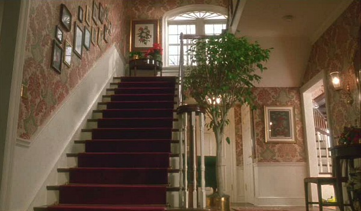
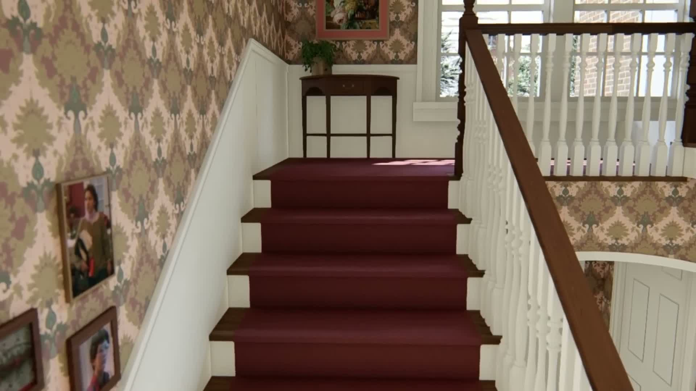

# Foyer proportion experiment: retain baseline, reject automatic narrowing

September 13, 2026. This completes an exploratory comparison and disposable-candidate test, **not dimensional sign-off**. No working scene or source asset was saved with the candidate.

## What was tested

Camera position, yaw, pitch and roll were fitted numerically to manually identified landmarks at vertical FOVs 40°, 60° and 80°. Stair width factors 0.45–1.15 were explored. [Inputs](landmarks.json), [all results](results.json), and [runnable fit with synthetic recovery check](fit.py) are retained. Approximate picking uncertainty is ±5 pixels in 1080p CG frames and ±3 pixels in the small film still. This is not a statistical confidence interval or a fully calibrated lens solution; lens distortion, image crop and exact tread correspondence remain uncertain. Tread points lie on one inclined plane and do not establish absolute scale independently.

The disposable Unity candidate reduced the stair-width strip X −0.943…1.170 by25%, from2.113m to1.585m. Geometry to its right translated0.528m left, rather than shrinking every room. Floor elevations, tread going and riser height were unchanged. This deliberately tests a connected horizontal compression, not a finished stair remodel. [Creation recipe](create-candidate.cs.txt), [walking check](check-candidate.cs.txt), [cleanup](restore.cs.txt).

All meshes were copies in Play mode; original roots were temporarily inactive. Candidate lighting is **not comparable**: baked lighting was not regenerated and cloned fixtures/normal recalculation alter shading. Read the captures for edges and proportions only. Box-collider deformation uses enclosing bounds; this is an exploratory collision proxy, not a final collider rebuild. No exterior change is proposed by this test.

## 1. Film stair view — width is not resolved

Reference: [film entry/staircase still](../../foyer-film/entry-staircase-reference.jpg), visible film geometry weight5; uncalibrated absolute dimensions weight1.

| Reference | Current geometry, fitted camera | 25% narrower candidate, refitted camera |
|---|---|---|
|  |  |  |

At the source's600×352 resolution, current geometry at80° has3.14px RMS landmark distance; the75%-width candidate at60° has2.58px. The0.56px difference is smaller than manual selection uncertainty. A55%-width result at40° also fits at2.67px. **These are competing camera/shape explanations, not evidence for a25% or45% reduction.** Absolute camera heights inherit model scale. Do not mistake the fitted cameras for measured filming positions.

Neither tread fit independently matches the ceiling opening, rear arch and window. The furniture/tree also obscure reference edges. Restoring those surrounding constraints matters more than optimizing a subpixel difference on stair edges.

## 2. Rear landing — narrowing improves the CG tread fit, but fails the independent check

Reference: Marina Part1 **5:46**, additional unmodified frame extracted this turn. Reconstruction relationship weight3; absolute dimensions weight1. This and the5:38 frame are the same source family, not two independent measurements.

| Reference | Current geometry, fitted camera | Narrower candidate, fitted camera |
|---|---|---|
|  |  |  |

At80°, tread RMS falls45.78→12.06px. However, the rear-left wall/floor corner was deliberately excluded from the fit: its prediction still misses by95.16px in the candidate (baseline141.78px). The baseline fit also demands almost15° of roll, visibly unlike the reference. Thus a width-only change does **not** solve the whole landing. Remaining causes include landing depth, camera constraints, reconstructed stair slope and landmark correspondence. This test does not isolate which of those must change.

## 3. Upper crosswalk — matching a door does not match the room

Reference: [supplied upper film view](../../foyer-film/upstairs-film-quality-target.png), visible relationships weight5. The current six-panel door was itself authored to a reference; it is not an independent dimensional anchor.

| Reference | Current geometry | Narrower candidate |
|---|---|---|
|  |  |  |

The60° camera fits the selected door details at2.36px RMS, but the foreground rail remains near the bottom of the capture rather than crossing at the film's door-knob level. The arch and wall-panel relationships also remain different. The candidate uses that same camera translated with the door; it does not correct these relationships. This is a failed full-room match despite a good door-only score. Do not adopt the camera's7.705m world elevation as the actual film camera height.

## Walking, adjoining spaces and decision

- Candidate: all11 stair/landing/crosswalk checkpoints pass without jumping. [Full log](candidate-walk.txt). Sampled headroom remains3.414m and3.021m above the first covered steps; this is not a complete headroom sweep.
- Compression leaves geometry entirely left ofX−0.943 unchanged and translates geometry entirely right ofX1.170 without changing its width. It nevertheless changes the central strip on **every floor** and deforms objects spanning it. Passing the stair route does not certify adjoining room fidelity; candidate bedroom/ensuite routes were not run and the candidate is rejected before promotion.
- Original11 roots restored; disposable copies and their meshes removed. Original main-stair route, parents-bedroom10 checkpoints, ensuite9 checkpoints, and Buzz14 checkpoints plus tarantula containment all PASS afterward. FPS restored, FOV75, point-light shadows remain off.

**Recommendation:** keep the working dimensions. Treat “narrow the entire central strip” as a tested but unaccepted hypothesis. The next structural solve must include off-stair-plane landmarks—rear wall/floor corner, window corners, ceiling edge and upper rail—in addition to treads/door details. The current evidence does not support an exact replacement width or floor height. Do not resume broad finishing under the assumption that the foyer is signed off.

## Applying Claude's checklist

Adopt the per-room frame inventory and conflict log. Modify its rules as follows:

- **Foyer provenance:** Marina introduces John Muto at Part1 4:09–4:14; at4:16–4:27 he describes building and distorting the staircase on stage for the sled exit. [Archived transcript](../../reconciliation/transcript.txt). This is his production account carried by the interview, separate from Marina's CG model. Strong weight5 for what he says they built,0 for an unstated numerical dimension. Automatic-caption wording remains transcription-limited.
- Set decorator Eve Cauley also describes separate first- and second-floor sets with stairs in a [direct Hunker interview](https://www.hunker.com/13723464/things-you-didnt-know-about-home-alone-set/). Therefore the checklist's categorical “foyer/landing—Real” is not an acceptable master-scale premise. Conflicting homeowner recollections exist; record provenance per shot instead of silently choosing a blanket label.
- Nominal80-inch doors, standard beds/counters and a person's estimated height are **priors**, not universal anchors. Verify the actual object/prop before converting pixels to metres. Riser count × measured rise gives height; riser count or horizontal run alone does not.
- Brick counts constrain an identified exterior opening only after brick/mortar module and perspective are established; they do not force a stage interior to the same scale. Listing photos must be dated and matched for renovations.
- Keep sequel/deleted-scene evidence labeled separately; it may support a hypothesis but cannot override the finished first film. Reflections can help, but are a mirrored view requiring correct geometry, not an automatically independent camera measurement.
- Preserve user priorities: detailed Buzz room including Jordan/tarantula; nonconnecting breakfast stairs accepted; basement fidelity deferred; interior takes precedence over exterior fit.

### Stitching log

| Conflict | Established evidence / current state | Decision |
|---|---|---|
| Breakfast stair arrival | Reconstruction's hypothetical exit conflicts with parents' suite | Accepted nonconnecting stair; no new upstairs opening |
| Basement entrance | User's overhead identifies entry beneath breakfast stair area | Retain that relationship; basement dimensional fidelity deferred |
| Main stairs / upper gallery | Film and interview support staged geometry; current route works; joint metric match unresolved | Preserve connectivity; reject automatic25% compression |
| Dining / breakfast | Two openings supported by supplied overhead; both traversable | Retain both |
| Attic connection | No calibrated evidence added in this experiment | Open; don't assign an arbitrary new arrival |
