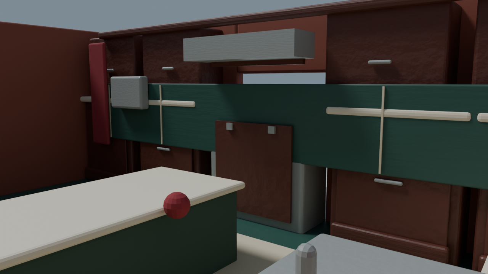
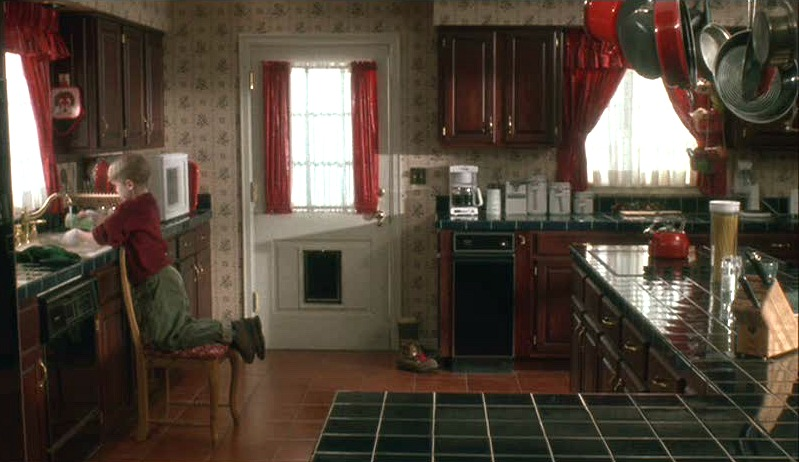
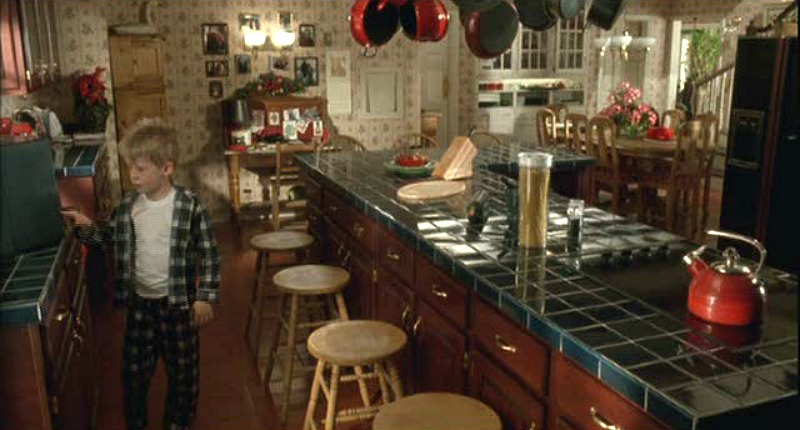
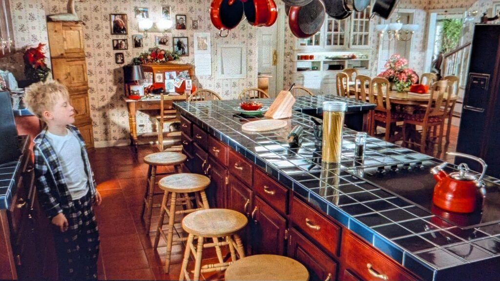
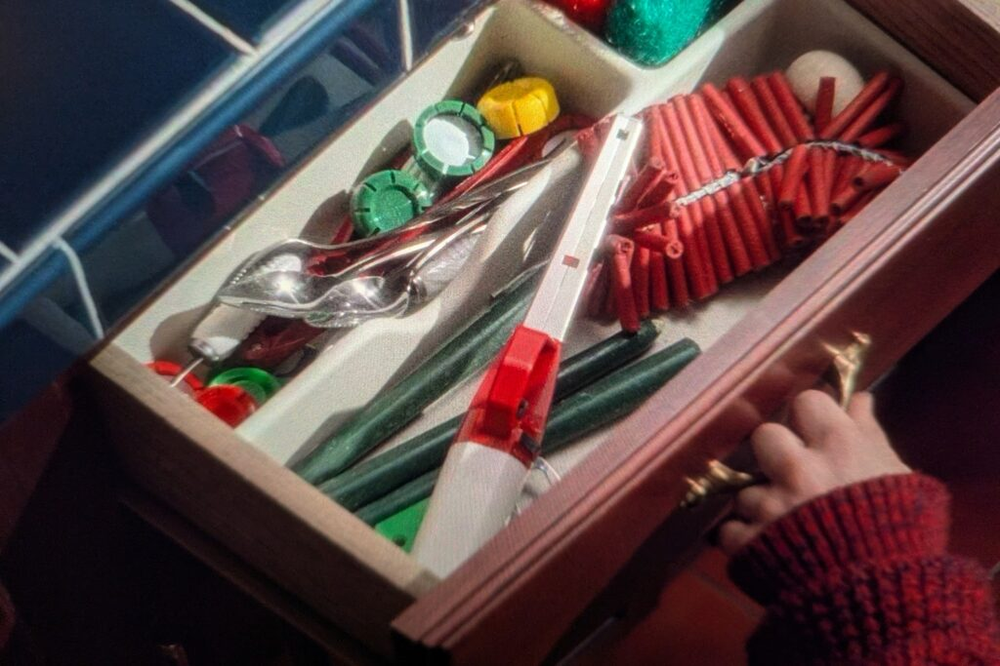
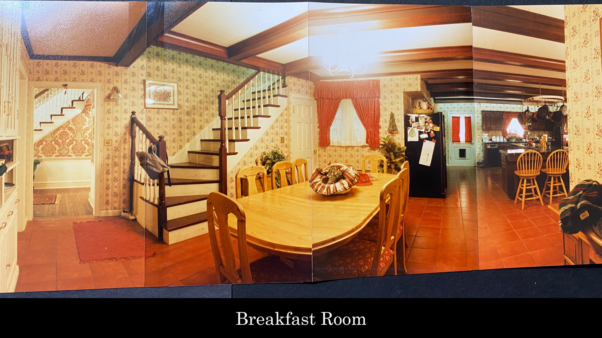
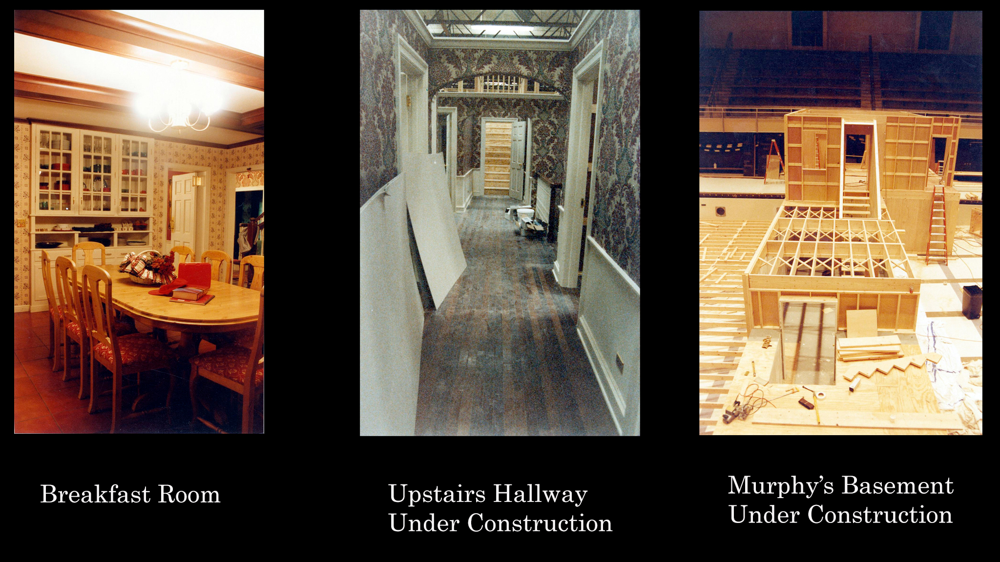
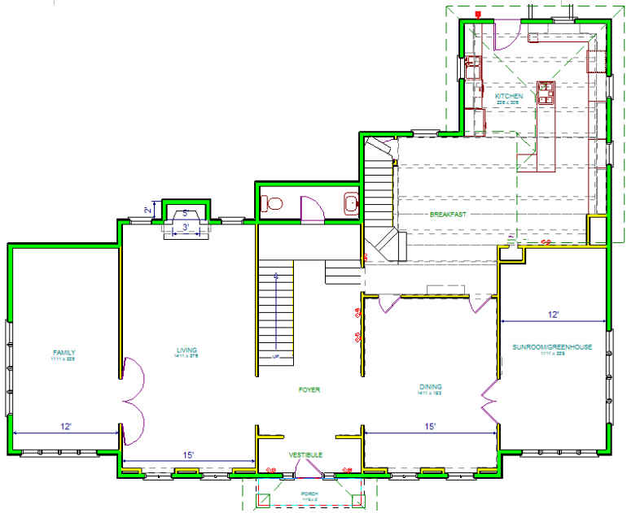

# Kitchen reference study

## Current Unity layout pass — September 14, 2026

The older generated Blender/Godot defects below do **not** describe the adopted IntactHouseReference scene. The [source weights](../dimensional-baseline/SOURCE_WEIGHTS.md) and current user priorities supersede the older blanket authority policy.

Inspected the native Unity cutaway against the [supplied Marina overhead](../reconciliation/first-floor-user-shots/06-ground-overhead.png). The L-shaped island and breakfast connection are present; breakfast table/chairs and island stools were missing. Added separate `Kitchen layout furniture` root via `KitchenLayout.cs`: oval1.05×2.80m table,8 breakfast chairs,5 stools along the island and3 at its short end. Simplified furniture is a **circulation blockout**, not final film joinery or verified furniture dimensions. Marina overhead has weight3 for arrangement,1 for inferred dimensions. No shell/island resizing or source-mesh edits.

Table centre X8.80,Z10.80, topY2.075 (approximately0.765m above floor). Initial centreX8.00 crowded the actual secondary stair, confirmed by controller failure and ray hits throughX6.70 at Z10.80. Moved table/chairs0.80m east without shrinking them. The existing chandelier is now offset from the table and needs later registration; lighting was not adjusted during this structural pass.

Counter-top rays sample island long leg X13.35..13.85 between Z13.5..15.5, cross-leg X11.85..13.85 at Z13.0, perimeter X15.75..16.50 where present. These0.05m-grid intervals understate full edges by up to one sample; top is aboutY2.29, roughly0.98m over floor. Exact island width versus the tour remains an open comparison, not justification for restoring historical generated kitchen dimensions.

Checks PASS: tabletop collision/winding, all16 seating objects and10 continuous checkpoints around table/island. [Updated20-checkpoint downstairs circuit](../structure-audit/downstairs-furnished-route.cs.txt) also PASS, including both dining/breakfast openings and foyer return. Original straight-line return crossed the new table, so route now goes around its end; no colliders removed. A separate rejected test waypoint hit the pre-existing entry wall atX10.5,Z8; corrected to the actual aisle atZ10.

[Cutaway before furniture](../../../../unity/HomeAlone/Assets/Captures/IntactHouseReference/kitchen-structure-overhead.png) uses temporary EV5/AA-off/lens overrides; [furnished walking view](../../../../unity/HomeAlone/Assets/Captures/IntactHouseReference/kitchen-seating-layout.png) uses normal lighting. Both inspected. Diagnostic camera and volume changes were discarded by leaving Play; only furniture was saved. Material fidelity, square floor tile, final chairs/stools and practical-light alignment are later work.

Compiled 2026-09-10. Target: the kitchen seen in the original 1990 film, including its breakfast-room connection. Scene/model files have not been changed by this study. [Implementation plan](../../../../tasks/plan.md).

Reference priority (user direction): **Marina Coates's tour is the primary authority**, including when reconciling the downloaded Blender asset, film stills and production photos. Use this packet to supplement details her tour leaves unresolved. Flag concrete ambiguities rather than routinely reopening her design choices. [Full reference policy](../tour/README.md#reference-priority--user-direction).

Later evidence update: [both tour transcripts and selected keyframes have now been analyzed](../tour/README.md). The narrator attributes **blue kitchen tile** to art director Dan Webster; this supersedes the green base-color inference from film stills. The long island is L-shaped, there are two window seats, and the reported kitchen-only area is 477 ft² (44.3 m²; not independently measured). Earlier descriptions of green below describe the images' appearance, not the corrected material specification.

Local-video update: [29 decoded Part 1 frames](../tour/main-frames.md) are now saved from the user-provided 640 × 360 MP4. [13:23](../tour/frames/M17-13m23s.png) confirms the 477 ft² figure onscreen and identifies the kitchen zone; [18:05](../tour/frames/M21-18m05s.png) and [18:17](../tour/frames/M22-18m17s.png) supply island/perimeter and sink/back-door views. Local access is resolved for Part 1 despite the earlier download failures.

## Visual evidence

### Current model

Saved from `art/home_alone/kitchen_detail.png` before any rebuild. This is a Blender preview, not a fresh Godot capture.

### Sink wall and back door

The sink belongs under a window in the perimeter counter. The curtained glazed back door sits between counter runs. Observe dark framed cabinet doors, green tiled worktops, pale grout, brass fittings, cream patterned walls, red drapes and the warm reddish floor. [Published film still, Hooked on Houses](https://hookedonhouses.net/wp-content/uploads/2011/05/Home-Alone-house-red-and-green-kitchen.jpg), via its [house article](https://hookedonhouses.net/2009/11/30/inside-the-real-home-alone-house/).

### Island and breakfast-room sightline

The long cooking island, row of stools and overhead cookware dominate the room. Breakfast seating, a hutch and the stair connection appear beyond it. [Published film still](https://hookedonhouses.net/wp-content/uploads/2011/05/Kevin-in-the-green-and-red-Home-Alone-kitchen.jpg), same article as above.

Use this view for the square tile grid, rounded tiled edge, dark cooktop, paneled drawers and curved brass pulls. Red kettle, knife block and pasta container provide recognizable silhouettes. This is the same film angle at higher resolution, not an independent layout confirmation. [Image](https://www.caseybarber.com/wp-content/uploads/2025/11/Home-Alone-kitchen-1024x576.jpg) from [Casey Barber's visual study](https://www.caseybarber.com/home-alone-house/).

Reference for shaped wood profiles, grain direction and hardware; drawer contents are not needed for the initial rebuild. [Image](https://www.caseybarber.com/wp-content/uploads/2025/11/Home-Alone-junk-drawer-1024x683.jpg), same Casey Barber article.

### Production photographs

This establishes the breakfast/kitchen connection, terracotta-colored floor, cream floral walls, dark ceiling beams, black refrigerator, pale back door, and island end seating. [Original image](https://static.wixstatic.com/media/24f4de_751ce4655e364d22ab252e21031edce9~mv2.jpg).

The left panel supplies the opposite breakfast-room view and white glazed hutch. The other panels show unrelated sets and do not establish kitchen geometry. [Original image](https://static.wixstatic.com/media/24f4de_d4f28870e3474578a03383ed2c8f8c06~mv2.jpg).

Both images are published by [Mockingbird Lane](https://www.mockingbirdlane.design/post/home-alone-in-depth), which attributes the supplied set photos to production designer John Muto and art director Dan Webster. These are photographed composite prints: seams, perspective and warm exposure make them unsuitable for exact dimension or color sampling. Other production images inspected covered bedrooms, living rooms and the Murphy house; they were excluded from this kitchen packet.

### Layout corroboration

[Visitor plan](https://hookedonhouses.net/wp-content/uploads/2009/11/Home-Alone-house-floor-plan-first-floor-2.jpg), published in the Hooked on Houses article. Useful for kitchen → breakfast → dining/foyer relationships. It depicts the real property from a visitor's reconstruction, not a surveyed film-set plan. Marina's tour takes precedence where references differ.

[Main-floor tour](https://www.youtube.com/watch?v=5GByoLZIzlM): 1:34 overhead plan; [13:06 kitchen discussion](https://www.youtube.com/watch?v=5GByoLZIzlM&t=786s); [14:34 kitchen tour](https://www.youtube.com/watch?v=5GByoLZIzlM&t=874s); 15:50 whole floor. Chapter metadata is saved in [tour-chapters.json](tour-chapters.json). Initially only metadata was available; the later [tour study](../tour/README.md) inspected automatic captions, storyboard thumbnails and kitchen playback in Safari. Full video download still returns HTTP 403. Treat the creator's CG geometry as reconstruction evidence, not a measured set plan.

## What is wrong now

Measurements below come from `tools/build_house.py`; material findings also come directly from the existing GLB, saved in [baseline-materials.json](baseline-materials.json).

| Finding | Evidence | Consequence |
| --- | --- | --- |
| Base units are 1.8 m tall; rear worktop top is 1.93 m | Lines 296, 357 | Rear work surface is around head height while the island top is 1.045 m |
| Backsplash spans height 1.075–2.225 m in front of cabinet faces | Lines 297, 303 | Green slab hides joinery instead of sitting behind the counter |
| Sink center x=10.1; side counter begins at x=10.475 | Lines 291, 310, 358–359 | Basin is mostly unsupported; solid stacked slabs do not form a bowl |
| Range occupies the center of the rear doorway | Lines 192, 306 | Layout conflicts with the exit; appliance has no collision so a traversal check can miss it |
| Floor is one green slab plus a cream rectangle | Lines 293–294 | No tile pattern; wrong material distribution compared with film |
| Kitchen is a 9.8 × 8 m undifferentiated room | Line 188 | No convincing distinction between working kitchen and breakfast area |
| All five exported kitchen materials lack texture maps | Existing GLB material JSON | Blender noise detail is absent from the game asset |
| “Brushed nickel” has metallicFactor=0 | Same JSON | Hardware behaves as a nonmetal |
| Image helper ignores rough_path and sends normal color into bump height | Lines 34–63 | Existing helper is not suitable as-is for new PBR kitchen maps |
| Kitchen preview has the Roof collection hidden, including kitchen ceiling | Lines 441–442; ceiling created in Roof | Preview lighting does not represent an enclosed room |
| Godot has a single kitchen omni light and no reflection probe | Preview scene | Weak grounding and no local reflection capture for glazed tile |

## Material brief

These are modeling starting values, **not measured specifications from the film**. Judge them in the actual room lighting.

| Surface | Target | Starting scale / treatment |
| --- | --- | --- |
| Worktops and short upstand | Blue glazed square ceramic with light grout and rounded edge tiles; assess the green film appearance under lighting | Tile module about 100–150 mm, grout 2–4 mm; roughness about 0.15–0.28, variation kept subtle |
| Cabinetry | Warm dark reddish stained wood, framed panels, shaped edge profiles | Grain along rails/stiles; satin roughness about 0.3–0.45; geometry for visible joinery |
| Floor | Terracotta / quarry-tile appearance | Trial module 200–300 mm; visible grid, restrained color variation, roughness about 0.5–0.7 |
| Wallpaper | Small floral repeat on cream ground | Dedicated kitchen pattern; do not reuse the foyer's large damask |
| Pulls / tap | Warm brass appearance | Metallic response; smooth curves and small bevels |
| Appliances | Dark refrigerator and cooktop, pale countertop appliance | Correct door seams, controls and scale before labels |
| Curtains | Gathered red fabric with light inner curtain | Real folds, valance, tiebacks; matte woven surface |
| Ceiling / trim | Cream plaster and dark wood beams | Enclosed room; beams and casing help establish human scale |

New production textures should be original or have explicit usable licenses. Reference images here are visual study sources, not licensed game textures. They remain excluded from Godot import by `art/home_alone/.gdignore`; no downloaded film image is embedded in the model.

Technical reference: [Blender glTF material export](https://docs.blender.org/manual/en/4.0/addons/import_export/scene_gltf2.html) describes tangent-space normal maps and supported texture connections. [Godot reflection probes](https://docs.godotengine.org/en/stable/tutorials/3d/global_illumination/reflection_probes.html) describe local reflection capture and interior settings. Prefer UV-mapped image textures and inspect the exported result directly.

## Unknowns to keep explicit

- No measured film-set plan, exact cabinet species, tile product or wallpaper manufacturer has been established.
- Scale should be solved from multiple views plus plausible counter/appliance dimensions; do not stretch furniture to fill the existing oversized shell.
- Rear service stairs appear in the breakfast reference. Their visible connection matters, but a functioning new stair/basement system is outside this kitchen realism pass.
- Stools and dressing vary between film shots and production photos. Match the selected film views consistently rather than combining every prop arrangement.
# September 14 fixture registration

Breakfast chandelier and its light now centre on the saved table atX8.8,Z10.8; fixture elevation and light intensity/shadow settings retained. Builder coordinates updated; scoped `AlignBreakfastChandelier()` is repeatable. Kitchen check now asserts ceiling rose/light alignment as well as its10-point furnished route. This is registration to the inferred furniture layout, not a newly measured film position.
