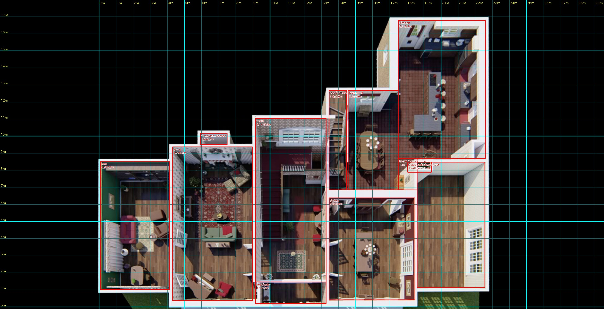
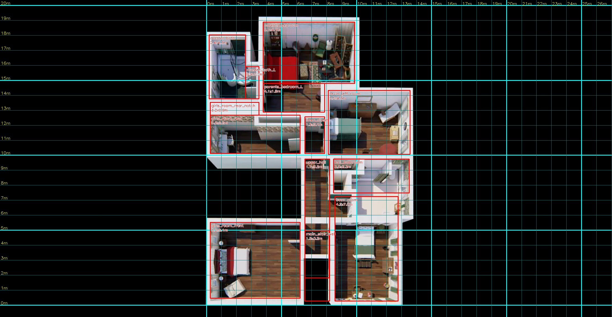
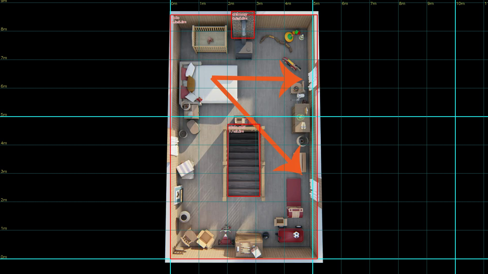

# House survey — dimensions from Marina Coates's tours

> **2026-09-11 reconciliation update:** Some claims below are superseded. [Frame/caption recheck and comparison packet](../reconciliation/README.md) confirms that Marina states 477 ft² for the working kitchen and the orange oval surrounds it; the later dismissal below was incorrect. This does not validate the original dimensional accuracy claim. Part 2 also places the basement door in breakfast. Read the packet before treating these estimates as construction dimensions.

Compiled 2026-09-11. This is the layout authority for the Unity rebuild: every room, opening and fixed element on all three floors, in metres, with the evidence and confidence for each number. Model against this before any joinery, materials or lighting. Machine-readable twin: [house_survey.json](house_survey.json).

## Calibration

Marina states floor areas onscreen. Those, not door widths or guesses, set the scale of each floor.

| Figure | Where | Value |
| --- | --- | --- |
| Main floor | Part 2, 11:01 ([frame](calibration-part2-floor-areas-11m01s.png)) | 2,620 ft² = 243.4 m² |
| Upstairs | same frame | 1,900 ft² = 176.5 m² |
| Attic | same frame | 476 ft² = 44.2 m² |
| Kitchen zone | Part 1, 13:23 ([frame](calibration-part1-kitchen-477sqft-13m23s.png)) | 477 ft² = 44.3 m² |

**Cross-check that passed.** With the ground-floor scale set only by the 2,620 ft² total, the kitchen rectangle measures 44.1 m² (475 ft²), within 0.5 % of Marina's separate 477 ft² figure. Two independent numbers agreeing this closely means the rectification, the room boundaries and the scale are all consistent. Ground-floor dimensions are therefore good to about ±0.15 m on walls and ±0.25 m on furniture.

## Method, briefly

1. The overhead views in the tours are perspective renders, not plans. Wall lines were detected automatically and a vanishing point fitted (residual 8 px). The images were then rectified to a true plan; the front of the house had been rendering ~17 % larger than the back.
2. Square terracotta tiles in the kitchen calibrated the depth-to-width ratio of the ground-floor rectification (measured 0.98–1.01, taken as 1.00).
3. Walls were measured at wall-top level, where all four faces of every room are visible. Floor-level items (furniture, cushions) were shifted by the measured wall-face parallax (103 px, about 1.3 m at floor scale) before conversion.
4. Openings with headers do not break the wall top, so cased openings were read from the wall faces, not the mask.

Sources: the user's clean overhead screenshot (Part 1, 2408×1350) for the ground floor; Part 2 at 0:50 for the upper floor ([source](upper-overhead-source-0m50s.png)); Part 2 at 14:00 for the attic, which is a true orthographic top-down ([source](attic-overhead-source-14m00s.png)). Scripts and probe files are in `tools/survey/`.

## Coordinate frame

Ground floor: origin at the front-left outer corner of the whole ground envelope (den's west outer wall, living room's front outer wall). **X** runs east (right in the overhead), **Y** runs toward the rear. All values are inner wall faces. Ground envelope: 22.7 m wide × 16.9 m deep. Wall thickness as modelled: 0.16 m.

Upper floor uses its own frame (see the alignment problem below): origin at the front-left outer corner of the upper block.

## Ground floor



| Room | X (m) | Y (m) | W × D (m) | Area |
| --- | --- | --- | --- | --- |
| Den | 0.09 – 4.10 | 1.02 – 8.51 | 4.01 × 7.49 | 30.0 m² (323 ft²) |
| Living room | 4.29 – 8.94 | 0.36 – 9.35 | 4.65 × 8.99 | 41.8 m² (450 ft²) |
| Fireplace recess (rear wall of living) | 5.92 – 7.47 | 9.49 – 10.14 | 1.55 × 0.65 | |
| Foyer (incl. vestibule) | 9.12 – 13.23 | 0.20 – 11.01 | 4.11 × 10.81 | 44.4 m² (478 ft²) |
| Vestibule (front strip of foyer) | 9.12 – 13.23 | 0.20 – 1.46 | 4.11 × 1.26 | |
| Dining room | 13.40 – 18.41 | 0.41 – 6.37 | 5.01 × 5.96 | 29.9 m² (321 ft²) |
| Sunroom | 18.54 – 22.48 | 1.14 – 8.46 | 3.94 × 7.32 | 28.8 m² (310 ft²) |
| Service stair bay | 13.40 – 14.42 | 6.84 – 12.64 | 1.02 × 5.80 | |
| Breakfast room | 14.52 – 17.05 | 6.84 – 12.64 | 2.53 × 5.80 | 14.7 m² (158 ft²) |
| Breakfast extension (in front of kitchen) | 17.05 – 18.54 | 6.84 – 8.66 | 1.49 × 1.82 | |
| Kitchen | 17.05 – 22.51 | 8.66 – 16.74 | 5.46 × 8.08 | 44.1 m² (475 ft²) |
| Closet off breakfast | 17.98 – 19.37 | 7.87 – 8.46 | 1.39 × 0.59 | |

Sum of interiors = 243.4 m², matching Marina's 2,620 ft² by construction. Note the breakfast room and kitchen are one open volume; the split at Y = 8.66 m is the kitchen's front wall line, which is also the sunroom's rear wall.

### Openings

| Opening | Wall | Position | Width |
| --- | --- | --- | --- |
| Den ↔ living, double doors (leaves fold back against the wall) | X = 4.10 | Y 1.83 – 3.59 | 1.76 m |
| Living ↔ foyer, cased opening | X = 8.94 | Y 1.71 – 3.47 | 1.76 m |
| Foyer ↔ dining, French doors | X = 13.23 | Y 1.71 – 3.59 | 1.89 m |
| Dining ↔ sunroom, French doors | X = 18.41 | Y 1.71 – 3.97 | 2.26 m |
| Foyer ↔ breakfast corridor, arch in foyer's east wall | X = 13.23 | Y 7.49 – 9.25 | 1.76 m |
| Corridor ↔ breakfast room | X = 14.43 | Y 6.85 – 8.47 | 1.62 m |
| Service stair landing ↔ breakfast | X = 14.43 | Y 10.90 – 11.79 | 0.89 m |
| Kitchen back door (glazed) | Y = 16.74 | X 17.86 – 18.61 | 0.75 m |
| Kitchen rear window (over sink) | Y = 16.74 | X 19.87 – 20.62 | 0.75 m |
| Vestibule inner door | Y = 1.46 | X 10.63 – 11.83 | 1.19 m |
| Front door (centre) | Y = 0.20 | X ≈ 11.2 | not resolved |

The four transverse openings all sit at Y ≈ 1.7 – 3.6 m, which is the aligned sightline Marina shows at 16:40. The foyer's rear wall (Y = 11.01) is solid apart from a single arched doorway at X ≈ 10.4 m whose far side is not modelled by Marina (Muto suggests a bathroom or the basement stair).

### Fixed elements

| Element | Position (m) | Notes |
| --- | --- | --- |
| Main stair | run along foyer west wall, X 9.12 – 10.4; foot at Y 3.7, top landing at Y 7.9 | rises toward the rear; landing across the rear at Y 7.9 – 9.1 under the arched window |
| Service stair | in the bay X 13.40 – 14.42; foot at Y 9.1, landing at Y 11.8 – 12.6 | rises toward the rear from the corridor; no upstairs arrival in Marina's model |
| Living fireplace | centred X 6.7 on the rear wall, in the 1.55 m recess | chimney breast |
| Kitchen back door | X 17.9 – 18.6 on the rear wall | pale glazed door |
| Sink | under the rear window, X 19.9 – 20.6 | |
| Refrigerator | rear-right corner, X ≈ 21.7 – 22.5 against the rear wall (Y 16.0 – 16.74) | dark unit at the east end of the rear wall, immediately beside the first window seat (M22, 18:17). **Not** at the breakfast transition as the earlier tour notes said |
| Island, long leg | X 19.8 – 20.6, Y 11.7 – 14.9 | 0.7 m wide, 3.3 m long, cooktop near the rear end; stools on the east side |
| Island, L foot | X 18.9 – 20.6, Y 11.7 – 12.2 | return toward the breakfast side |
| Window seat 1 | east wall, centred Y ≈ 14.3 | red cushion |
| Window seat 2 | east wall, centred Y ≈ 12.0 | red cushion |
| Breakfast table | centred X 15.7, Y 9.1 | oval, long axis Y |
| Dining table | centred X 15.9, Y 3.5 | long axis Y |
| Hutch | breakfast west wall, near Y 10 – 12 | pale glazed, per M18/M23 |

Ceiling height, ground floor: 2.6 – 2.9 m from door-to-ceiling ratios in the eye-level frames. Use 2.75 m until a better measurement exists. Kitchen ceiling carries dark beams.

## Upper floor



Scale set by the 1,900 ft² figure alone; no second onscreen number exists to cross-check it, so treat these as ±5 %. Frame origin is the upper block's own front-left outer corner.

| Room | X (m) | Y (m) | W × D (m) | Area |
| --- | --- | --- | --- | --- |
| Parents' bedroom | 3.77 – 9.87 | 14.80 – 18.90 | 6.10 × 4.10 | 25.0 m² |
| Parents' bedroom, L extension | 3.77 – 7.87 | 12.89 – 14.80 | 4.10 × 1.91 | 7.8 m² |
| Master bath | 0.17 – 2.60 | 13.78 – 18.05 | 2.43 × 4.27 | 10.4 m² |
| Master bath, L | 2.60 – 3.49 | 13.78 – 15.94 | 0.89 × 2.16 | |
| Girls' room (rear, desk and small bed) | 0.24 – 6.23 | 10.13 – 13.54 | 5.99 × 3.41 | 20.4 m² |
| Linen closet | 6.55 – 7.87 | 10.13 – 12.58 | 1.32 × 2.45 | |
| Kevin and Jeff's room | 8.11 – 13.56 | 10.07 – 14.34 | 5.45 × 4.27 | 23.3 m² |
| Hall bathroom | 8.46 – 13.51 | 7.49 – 9.76 | 5.05 × 2.27 | 11.5 m² |
| Upper hall | 6.55 – 8.20 | 0.28 – 9.76 | 1.65 × 9.48 | 15.6 m² |
| Main stair well (in hall) | 6.55 – 8.16 | 1.82 – 4.97 | 1.61 × 3.15 | |
| Girls' room (front, double bed) | 0.24 – 6.23 | 0.46 – 5.53 | 5.99 × 5.07 | 30.4 m² |
| Buzz's room | 8.55 – 12.76 | 0.28 – 7.25 | 4.21 × 6.97 | 29.3 m² |

Attic door: at the rear end of the upper hall, near the linen closet. Upstairs ceiling height: unmeasured.

## Attic



One room, 5.15 × 8.58 m (44.2 m² by construction). Stair well 1.12 × 2.53 m, centred across the width, 3.8 – 6.4 m from the rear wall. Brick chimney 0.8 m wide on the rear wall, centred at X ≈ 2.5 m, projecting 0.8 m. Beds, dressers and the wardrobe follow the source frame.

### Breakfast and kitchen zone, corrected 2026-09-11 (later)

The first Unity blockout gave every survey rectangle four walls, which partitioned the breakfast area into a maze. Marina's 13:10 kitchen overhead (rectified with the same pipeline, VP residual 0.8 px) and the [real-house first-floor plan](https://hookedonhouses.net/2009/11/30/inside-the-real-home-alone-house/) agree on the actual form:

- **One open L-shaped volume.** The service-stair bay, breakfast room, breakfast extension and kitchen have no interior walls between them. The survey rectangles are zones of one room; only the exterior walls, the dining party wall and the sunroom walls are real.
- **Service stair.** Open flight up the west wall behind a balustrade (M23), foot at Y ≈ 9.1 rising rearward to a landing at Y 11.7 – 12.64 about 1.85 m up, enclosed at the top in Marina's model. In the real house the stair continues with winders to arrive beside the master bath.
- **Breakfast front wall (Y = 6.84), west to east:** single door into the dining room at X ≈ 14.6 – 15.5 (seen as the door leaf in M23), the pale glazed hutch at X ≈ 15.6 – 17.0, French doors into the dining room at X ≈ 17.1 – 18.45 (M24). The real plan shows the same two doors with a sideboard between them. Door positions are scaled from the real plan, ±0.3 m.
- **Closet** is a niche in the sunroom's rear wall at X 18.0 – 19.3, opening north into the kitchen zone; the **desk** stands against the sunroom's west wall at Y 7.9 – 8.6 facing west (M15).
- **Breakfast rear wall** carries one window at X ≈ 14.7 – 15.4 with a red valance.
- **Powder room.** The real plan has a bath behind the living/foyer entered from the rear hall. Marina leaves the foyer's rear arch blank. The blockout adds a small powder room behind the arch as a labelled adaptation.
- **Real-house widths** (12 / 15 / 15 / 12 ft for family, living, dining, sunroom) run 5 – 8 % smaller than Marina's model. Marina governs; the set was built larger than the house.

Same-scale comparison of Marina's overhead and the corrected blockout: [compare-kitchen-top.jpg](compare-kitchen-top.jpg).

**Second correction, same day, from the film still Marina shows at 13:15 (the pizza scene) and a re-read of the wall faces:**

- **Stair direction, resolved.** A first attempt read the pizza-scene still (13:15) as foot-at-rear and was wrong in the walkthrough. The weight of evidence is foot at the **front**: Marina's overhead shows the raised landing platform at the rear end of the bay and a winder at the front; the real-house plan has the foot winder at the front; and her 17:47 foyer frame (M20) shows the cased opening to the breakfast room at the **rear end** of the foyer's east wall (Y ≈ 9.8 – 11.0), which the wall-top mask also shows as a gap. That corridor passes under the stair landing. The film still is either flopped for screen direction or shot from an angle I misjudged. The blockout now has the newel at Y ≈ 7.2, the flight rising rearward along the west wall at 40°, and a landing across Y 9.8 – 12.64 at 2.2 m with 2.0 m headroom beneath. The survey's earlier "arch at Y 7.49 – 9.25" was a misread wall face and is withdrawn.
- **Hutch** stands against the stair's stringer wall facing the table (Y 8.6 – 10.4), which puts hutch, corridor door leaf and doorway in a row as M18 and M23 show. The west dining door from the real plan is dropped; Marina's model connects dining to breakfast by the French doors only (M24).
- **Kitchen west wall.** The 41 px band on the user overhead is the wall's lit outer face plus its top. Reading the top only puts the inner face at X ≈ 17.5, not 17.05, which Marina's 13:10 frame confirms independently (both frames then agree at 92 px/m). Kitchen is 5.08 × 8.11 m, 41.2 m² (443 ft²). The earlier "475 ft² matches 477" cross-check was therefore partly coincidence: Marina's 477 ft² is not the kitchen rectangle. Her orange oval at 13:10 circles the breakfast and stair zone, and the figure may be the real house's kitchen label. The floor-total calibration (2,620 ft²) does not depend on it.
- **Breakfast table** moved 0.3 m east to centre X 16.25, Y 9.5, within the parallax uncertainty of a floor-level object, so the aisle between the stair rail and the chairs is 0.9 m.
- The Unity build now runs a capsule clearance sweep (adult, r 0.3 m) along the whole ground-floor route after every build and logs any blocked segment.

## Discrepancies that need a decision

These are real inconsistencies in the source, not measurement noise. Each needs an authored answer before the block-out is built.

1. **The upper floor does not stack on the ground floor.** The upper block's facade measures 13.0 m against 14.4 m for the ground floor's main block (living + foyer + dining). The upper floor's front-to-back depth comes out at 19.2 m, deeper than the entire house (16.9 m). And the main stair well upstairs sits 6.5 – 8.2 m from the block's west edge, whereas the foyer stair below is at 5.0 – 6.4 m. Muto says the upstairs set was built separately, and Marina's two overheads are separate models. Recommended: keep the upstairs room proportions, then compress its depth and shift the hall so the stair well lands over the foyer stair, and widen the front rooms to the ground-floor facade. The parents' suite then sits over the breakfast/kitchen wing.
2. **Service stair has no upstairs arrival.** Confirmed by Muto (Part 2, 6:58). Any connection to the upper hall is an adaptation.
3. **Foyer rear arch leads nowhere.** Reserve a basement stair or powder room behind Y = 11.01 m.
4. **Attic placement.** Its chimney and the living-room chimney breast suggest it sits over the living room / foyer boundary, but the attic door is at the rear of the upper hall. Resolve when the upper floor is stacked.
5. **Front entry detail.** Vestibule depth (1.26 m) and inner door width are read from a shadowed region; the front door position is an estimate.
6. **Refrigerator.** The earlier tour notes placed it at the breakfast transition. M22 (18:17, looking at the rear wall from the island) shows back door at the west end, sink window in the middle, and the dark refrigerator at the east end beside the window-seat wall. The survey value wins.

## What this changes in the current Marina generator

Compared with `tools/build_marina_interior.py` (kitchen sized as 5.2 m wide × 8.5 m long to hit the area): the surveyed kitchen is 5.46 × 8.08 m, so the room is wider and shorter than modelled. The breakfast room is only 2.53 m wide beside a 1.02 m stair bay, not the wide space currently generated. The fridge belongs against the west wall near the back door, not free-standing. The four transverse openings should sit 1.7 – 3.6 m behind the front wall. The sunroom is 3.94 m wide, not a narrow side room.

## Reproduce

```sh
# vanishing point + rectification + wall mask (ground example)
python3 tools/survey/vp.py art/home_alone/references/tour/ground-floor-user.png /tmp/g_lines.png
python3 tools/survey/rectify.py art/home_alone/references/tour/ground-floor-user.png /tmp/g_lines.png.vp.npy /tmp/g_rect.png
python3 tools/survey/mask.py /tmp/g_rect.png /tmp/g_mask.png
python3 tools/survey/probe.py /tmp/g_mask.png tools/survey/ground_probes.json /tmp/g_walls.json
# metre tables, JSON and annotated plans (paths inside are fixed to the scratch layout; edit S/OUT to rerun)
python3 tools/survey/survey_out.py
```

Requires Python 3 with OpenCV and NumPy. Full-resolution versions of Astra's 29 Part 1 keyframes, taken from the 1080p file, are in [../tour/frames-hd/](../tour/frames-hd/).

**Correction 2026-09-11 (later):** the rear girls' room is L-shaped: main body X 0.24 – 6.23, Y 10.13 – 12.69, plus a notch X 0.24 – 3.49, Y 12.69 – 13.54 beside the parents' bedroom's extension. The JSON carries both rectangles. Stacking decision adopted for the Unity blockout: upper floor mirrored in X (so the hall lands over the foyer stair), X scaled 13.02 → 14.44 m, Y compressed so the rear wall meets the kitchen's rear wall line; see `unity/HomeAlone/Assets/Scripts/SurveyHouse.cs`.
