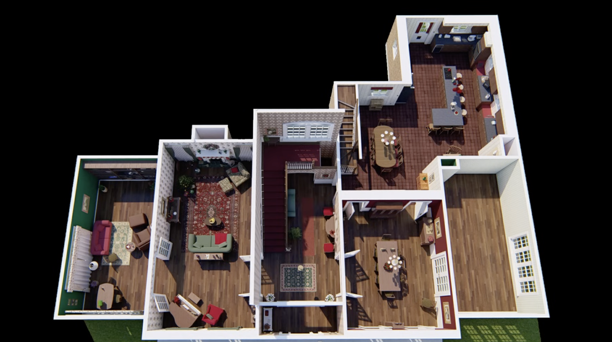
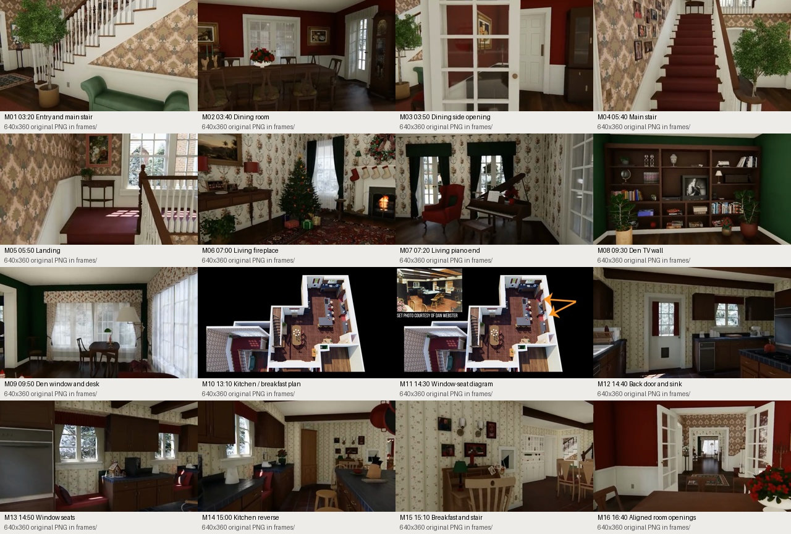
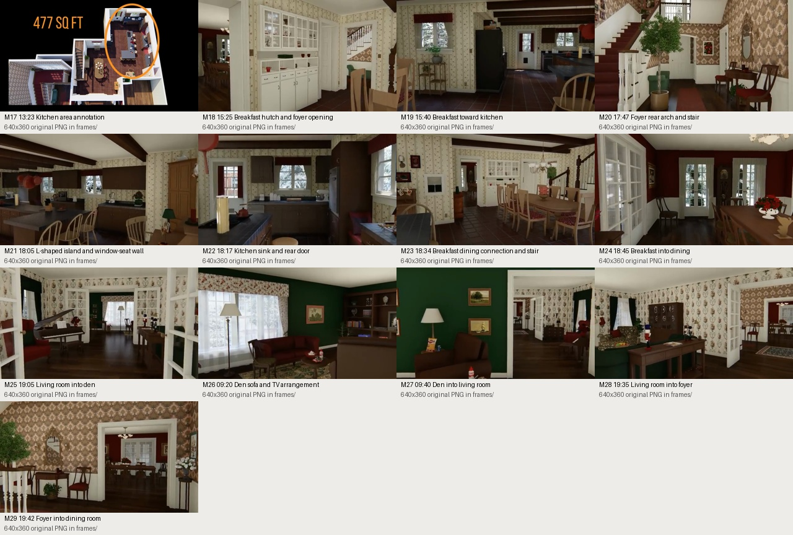
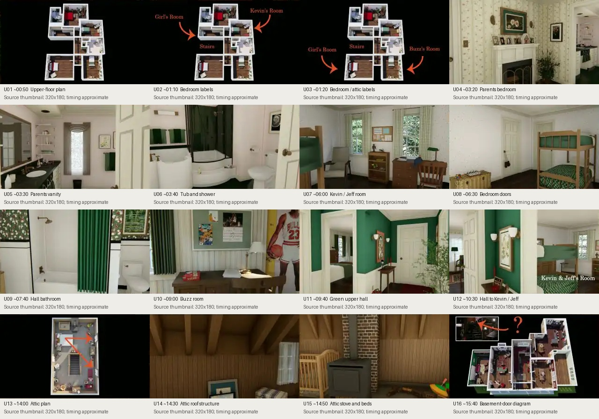

# Home Alone — reconstruction evidence study

Compiled 2026-09-10. Target: a continuous, realistically rendered version of the **1990 film interior**, using Marina Coates's CG tours as spatial references. This study changes reference documentation, not the Blender model or playable scenes.

We now have substantially better evidence than the first blockout. The tours can guide room relationships, openings, furniture placement, surface patterns and camera comparisons. They do **not** establish measured construction drawings or make every room and stair physically consistent.

## Reference priority — user direction

Marina Coates's tours and the model shown in them are the primary authority for this recreation. When references disagree, follow Marina's visible layout, proportions, furnishings and finishes. The downloaded Blender asset is a starting point to correct against her tours. Film stills, production photos and real-property plans supplement details her videos do not resolve; they do not automatically override her reconstruction. Raise a question only for an actual ambiguity, contradictory tour views, or a physical connection her model does not establish. Missing measurements alone are not a reason to substitute the downloaded asset's geometry.

## What was actually inspected

- The user's full-resolution overhead screenshot, preserved as [ground-floor-user.png](ground-floor-user.png).
- English automatic captions for the complete [main-floor tour](https://www.youtube.com/watch?v=5GByoLZIzlM) and [upstairs/attic tour](https://www.youtube.com/watch?v=kU7aY1anpAI). Automatic captions can mistranscribe names and numbers; reported statements below are attributed, not independently certified.
- The user-provided main-floor MP4: **29 selected frames decoded at native 640 × 360 resolution**, with individual PNGs, two contact sheets, exact requested timestamps and a [clickable frame index](main-frames.md). This replaces the main-floor storyboard thumbnails. The video is 25 fps; its embedded 1280 × 720 cover image is not the video's resolution. Source identity and stream information are saved in [local-video.json](local-video.json).
- The upstairs tour's storyboard images: **16 selected 320 × 180 thumbnails** remain in the upstairs contact sheet. Their timestamps are approximate 10-second samples. The user-provided Part 2 MP4 is now archived with metadata and a 24-frame local keyframe sheet under [part2/](part2/).
- Safari playback of the kitchen overhead around 13:18 and interior views around 14:57, 15:17 and 15:32. These supplied a larger visual check of the kitchen, breakfast room and stair. These Safari screenshots are not saved in this packet.
- The existing [film-still and production-photo packet](../kitchen/README.md). The creator's [companion page](https://www.mockingbirdlane.design/post/home-alone-in-depth) attributes its production photographs to John Muto and Dan Webster.

Earlier video download attempts returned HTTP 403; the user-provided MP4s now resolve local access for both floors. Captions and storyboard downloads succeeded for both tours. Raw caption files and working indexes are temporarily in `/tmp/home-alone-tour`; the durable deliverable here is the analysis, selected frames and source index. Extracted frames are without enhancement.

## Corrections that affect the build

| Evidence | Finding | Modeling consequence |
| --- | --- | --- |
| Part 1 [14:05–14:23](https://www.youtube.com/watch?v=5GByoLZIzlM&t=845s), M13–M14 | Coates reports that Webster identified the kitchen tile as **blue**. | Supersedes the earlier green-tile material brief. Start with blue ceramic; compare its appearance under film-like lighting before tuning toward the green appearance in some stills. |
| Part 1 [13:23 frame](frames/M17-13m23s.png), M10/M17 | **477 ft²**, approximately **44.3 m²**, is confirmed as onscreen text as well as narration. The orange oval identifies the long kitchen zone beside the breakfast area; the island is L-shaped. | Adopt Marina's stated kitchen area as the scale target. The oval identifies the zone but is not a precise wall-boundary trace; solve the outline and camera together. Do not stretch the room or use a short rectangular island to fit the current shell. |
| Part 1 [14:26](https://www.youtube.com/watch?v=5GByoLZIzlM&t=866s), M11–M13 | Two window seats interrupt the kitchen perimeter. | The side wall cannot be one uninterrupted counter run. Recesses, seat heights, curtains and upper cabinet breaks affect the entire elevation. |
| Part 1 [16:31–17:19](https://www.youtube.com/watch?v=5GByoLZIzlM&t=991s), M16 | Dining, foyer, living room and den have aligned wide openings. | Preserve this cross-house sightline before furniture, trim or collision is added. |
| Part 1 [04:16–04:37](https://www.youtube.com/watch?v=5GByoLZIzlM&t=256s) | Muto describes a deliberately distorted main stair for the sled shot; a vestibule separates stair and front door. | Do not assume the real property's stair pitch or dimensions reproduce the film. Match the visible stair and entrance composition. |
| Part 2 [06:58–07:25](https://www.youtube.com/watch?v=kU7aY1anpAI&t=418s) | Muto says the breakfast-room stair did not emerge on the second-floor set; its hypothetical arrival is near the parents' room. | A working rear stair requires an authored connection. Preserve its downstairs appearance and label any upstairs integration as an adaptation. |
| Part 2 [06:35–06:56](https://www.youtube.com/watch?v=kU7aY1anpAI&t=395s), [09:26–09:40](https://www.youtube.com/watch?v=kU7aY1anpAI&t=566s) | One daughter's room was only partially built; the other is identified but not shown inside in the film. | Their complete interiors cannot be called film-verified. Do not treat the CG flybys as measured evidence. |
| Part 2 [11:04–11:25](https://www.youtube.com/watch?v=kU7aY1anpAI&t=664s), U11–U12 | The upper hall's finished green walls differ from earlier construction photographs showing downstairs-style wallpaper. | Use the finished-film hall treatment; distinguish construction-stage references. |
| Part 2 [15:35–15:53](https://www.youtube.com/watch?v=kU7aY1anpAI&t=935s), U16 | The interior basement entrance is identified in the breakfast room. | Preserve this door and reserve a plausible stair volume; the video does not establish a complete basement plan. |

## Ground-floor layout constraints

Read this image with the front entrance at the bottom. “Left” and “right” below refer to this image, not geographic directions.

- **Central foyer:** a shallow front vestibule, long hall, main stair on its left, and rear landing/window area. A rear opening leads toward the breakfast room. The narrated suggestion of a bathroom behind the rear arch is explicitly uncertain.
- **Living room, left of foyer:** a long front-to-back volume. Piano and red wingback chair occupy the front end; fireplace, seating and small Christmas tree occupy the far end. Preserve the different usable zones rather than centering one sofa in an empty room.
- **Den, far-left wing:** green walls, a large window/desk end, sofa and leather seating, and a broad television/bookcase wall at the opposite end. Opening alignment with the living room matters more initially than individual shelf contents.
- **Dining room, right of foyer:** red walls, centered dining furniture, white lower trim, glazed display furniture and wide doors. The room beyond it on the far right is described by Coates as a likely sunroom; its film interior is not established. Leave its furnishing confidence low.
- **Breakfast room, behind dining:** widened gathering space with table/chairs, pale glazed hutch, stair and door group. It connects the central circulation to the working kitchen. The shared tile floor does not make it the same functional zone as the cooking aisle.
- **Kitchen, projecting rearward on the right:** long working zone with the L-shaped island on its long axis. In the overhead image the sink/back-door grouping is at the far end, the window seats interrupt the right perimeter, and the refrigerator marks the transition toward breakfast. Verify these directions against the camera view before coding coordinates.

Doorway constraint: **den ↔ living ↔ foyer ↔ dining** forms the transverse view; **dining ↔ breakfast ↔ kitchen**, with an additional **foyer ↔ breakfast** connection, creates the circulation loop. This is a topology to preserve, not a metric plan.

## Selected main-floor frames

Each card's ID maps to [keyframes.json](keyframes.json), including its timestamp, source URL and native PNG path. Use the [clickable frame index](main-frames.md) to open the individual images at full source resolution. Contact sheets are reduced previews.

| Cards | MP4 extraction times | What to constrain |
| --- | --- | --- |
| M01–M03 | 03:20, 03:40, 03:50 | Vestibule, dining furniture, door widths and side-room opening |
| M04–M05 | 05:40, 05:50 | Main stair run, turn, railing and landing window; M04 now uses the unobstructed CG view rather than the earlier film/annotation shot |
| M06–M07 | 07:00, 07:20 | Fireplace end versus piano end of living room |
| M08–M09 | 09:30, 09:50 | Den built-in wall versus window/desk end |
| M10–M11 | 13:10, 14:30 | Kitchen outline, breakfast offset and window-seat locations |
| M12–M15 | 14:40, 14:50, 15:00, 15:10 | Sink/back door, perimeter breaks, island, cookware, breakfast stair and hutch |
| M16 | 16:40 | Alignment and layered wall treatments across four rooms |

The kitchen playback also shows dark beams crossing a pale ceiling, suspended cookware above the island, small floral motifs arranged in vertical bands, dark wood cabinet doors and drawers, blue tile grids with lighter joints, reddish gridded floor tiles and white stair balusters with a dark rail. These are visible characteristics; wood species, tile manufacturer, precise grout width and historic paint codes remain unknown.

### Additional views from the local MP4

- **M17, 13:23:** readable area annotation and its kitchen-zone marker.
- **M18/M23, 15:25 and 18:34:** the breakfast hutch, opening toward the foyer, separate opening into the red dining room, and service-stair group. Preserve the doorway placement and the hutch's wall space together.
- **M19/M21/M22, 15:40, 18:05 and 18:17:** complementary views of the working kitchen. The island return projects toward breakfast with seating at its edge; the window-seat recesses interrupt the opposite cabinet elevation. The sink and glazed back door share the far wall, and the refrigerator sits near the breakfast transition. These views constrain aisle clearances without inventing appliance sizes from the old asset.
- **M20, 17:47:** foyer rear arch, main stair, wall finish and furniture establish the kitchen-side approach.
- **M24/M25/M27–M29, 18:45, 19:05, 09:40, 19:35 and 19:42:** reverse room connections supplement the long four-room view. Door leaves, frames and nearby furniture must preserve the visible sightlines in both directions.
- **M26, 09:20:** the den's sofa/window, leather seating and TV/bookcase arrangement can now be checked as a group.

These frames confirm spatial and visual constraints; they have not yet been used to fit metric geometry or revise the 3D model. The user's original overhead screenshot remains the sharpest saved whole-floor plan image.

## Upstairs and attic

| Cards / source | What we can use | What remains unresolved |
| --- | --- | --- |
| U01–U03, [00:48–01:22](https://www.youtube.com/watch?v=kU7aY1anpAI&t=48s) | Labeled upper plan: parents' suite, two daughters' rooms, Kevin/Jeff room, Buzz room, hall bathroom and attic entry | Accurate wall offsets, heights and relationship to the downstairs footprint need a larger plan frame |
| U04–U06, roughly 03:20–03:40 | Parents' room fireplace, red bedding/curtains, adjoining vanity and tub/shower composition | Full fixture dimensions and wall-by-wall elevation measurements |
| U07–U08, roughly 06:00–06:30 | Shared Kevin/Jeff bedroom, bunk-bed arrangement, drawers and doors | Exact bed, window and closet offsets |
| U09, roughly 07:40 | Hall-bathroom layout cues and contrasting wall/wainscot treatment | Areas hidden by the selected view |
| U10, roughly 09:00 | Buzz's room scale cues, furniture and wall dressing | Fine poster content is not needed to solve the room |
| U11–U12, roughly 09:40–10:30 | Green upper hall, white trim and room entrances | Continuous service-stair arrival is not established |
| U13–U15, roughly 14:00–14:50 | Attic plan, steep exposed roof structure, timber lining, beds, stove/chimney and storage | Roof pitch, knee-wall height, chimney continuity and exact stair hole need calibration |
| U16, roughly 15:40 | Basement entrance location diagram | Entire basement geometry and exterior-stair relationship |

Part 2 [13:50–14:08](https://www.youtube.com/watch?v=kU7aY1anpAI&t=830s) distinguishes two front attic windows from the rear escape window. Their placement must work with the roof and exterior, not merely decorate the attic shell. Existing generic upstairs rooms and attic geometry should be treated as placeholders during this pass.

## How to turn this into a faithful 3D house

1. **Solve the plan and cameras together.** Trace wall intersections and door centers from the clean overhead, then use the room tours to check connections and sightlines. The supplied image is oblique: pixel lengths have perspective distortion, so tracing its silhouette directly into metric coordinates would be wrong. Use rectification or camera matching with several wall corners and right-angle constraints. Do not infer a meter scale from one sofa.
2. **Calibrate scale with independent anchors.** Compare candidate geometry against doors, counter heights, stair steps, beds and appliances in several views. A worktop around 0.90–0.93 m is a proposed calibration assumption, not a measured film dimension. Use the reported 44.3 m² kitchen as another check; it cannot uniquely determine width and length. Record the scale choice and how much each anchor disagrees.
3. **Resolve vertical continuity explicitly.** Fit the main landing, upper corridor, attic stair, roof and chimney as one section. Reserve basement stair space. Keep a small list of authored departures for the rear-stair connection and unbuilt rooms; do not distort every visible room to hide one impossible connection.
4. **Build and compare an undecorated shell.** Use the existing Blender generator and Godot walkthrough. Capture a matched overhead, the four-room sightline, both kitchen directions, stair landing, upper hall and attic. Correct proportions before producing expensive furniture and textures. Free-camera inspection alone does not validate human-scale circulation.
5. **Add fixed architecture and large furniture.** Moldings, door leaves, window recesses, stair profiles, cabinet joinery, L-shaped island, window seats and major furnishings determine recognizable silhouettes. Make counter heights, clearances and doorway placement explicit values rather than cumulative offsets spread through the generator.
6. **Finish materials in actual interior lighting.** Match Marina's tour for arrangement and finishes; use film/production close-ups to fill unresolved detail. Separate blue tile base color from lighting and grading. Match wallpaper repeat size, wood grain direction, fabric folds, bevel scale and reflections at walking distance. Ceiling, curtains and window placement must already exist when judging the light.
7. **Validate the exported scene.** Compare Godot captures from the reference cameras with matching framing; inspect material maps, roughness, normals and contact shadows. Test both stairs, the front entrance, the room loop and furniture clearances using the existing movement harness. Record any remaining visible mismatch rather than declaring accuracy from a successful import.

Suggested visual acceptance: no missing reference-visible opening; the four-room view stays aligned; kitchen perimeter recesses and L-shaped island agree in both directions; landings and attic windows agree with the plan; no furniture scaling to fill incorrect room sizes. A numerical image-error threshold should wait until camera poses and larger reference frames are fixed.

## Remaining evidence to obtain before detail modeling

- Local Part 2 footage, especially the upstairs and attic plans and stair transitions. Its current thumbnails support navigation through the evidence, not fine measurement. HD Part 1 would improve small surface details, but the available 360p frames and original overhead already support the layout pass.
- Additional views where an opening or wall remains occluded; the saved main-floor reverse views now cover the major room connections and both kitchen directions.
- A fitted kitchen boundary consistent with Marina's confirmed onscreen 477 ft² area; the oval alone does not supply edge dimensions.
- A documented choice for continuous rear stairs, unseen bedrooms, sunroom and basement. These gaps remain even with higher-resolution video because the film sets did not define all of them.

Keep reference images in this study directory under `art/home_alone/.gdignore`; they are not production textures. [Main chapters](main-chapters.json), [upstairs chapters](upper-chapters.json) and the [frame manifest](keyframes.json) make subsequent capture and modeling work repeatable.
