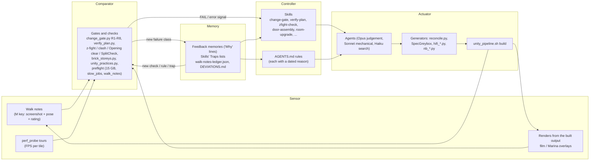

# Measure, Gate, Walk, Repeat

## Rebuilding the McCallister house from a YouTube tour, county LiDAR and the film, with agents held to account by a feedback loop

*Draft for the show-and-tell post and talk. Every number below comes from the repo: git history, `docs/`, `.claude/skills/`, `tools/` and the project's feedback memory.*

[[IMG 1]]

---

## The brief: faithful, true scale, and Kevin is small

The goal fits in the first line of `AGENTS.md`: "a faithful, walkable Unity recreation of the McCallister house. Faithfulness is non-negotiable; do not propose 'good enough' geometry."

Two constraints shaped everything after that:

- **Scale the players, not the house.** The house is built at true scale. The feel comes from the bodies (`docs/RECONCILIATION.md`). Kevin's eye is at about 1.1 m and his capsule can crawl under a bed. The bandits' eyes are at about 1.7 m, and the adult capsule has to pass every doorway and stair with headroom. A bed marked `hideable` must fit Kevin's crawl capsule and not the adult's.
- **Every number traces to evidence.** No dimension is accepted without a re-runnable script, a spread, and a check on views that weren't used to build it.

The sources disagree, so each one is the authority for a different thing (RECONCILIATION.md):

| Source | Authority for |
|---|---|
| Marina Coates's two CG tour videos (about 38 min), measured with structure-from-motion | Room shapes, sizes, adjacency, furniture placement |
| The film (1990) | The look, and where things are when the film shows them |
| The real house in Winnetka: photos, OSM, Cook County parcels and footprints, the 2022 Illinois LiDAR | The exterior envelope, the lot, the street |
| Marina's stated floor areas (2,620 / 1,900 / 476 ft²) | A cross-check on scale |
| John Muto's set model (production designer) | Which rooms adjoin which on the set |
| An old downloaded GLB of the house | Basement, attic, treehouse and yard, once registered to our house |

On Oct 18 the user set the tie-breaker for everything: "Film and marina fallback should be the pattern followed unless otherwise specified." Geometry still comes from Marina's tour where the film has no ruler. What things look like, and where they sit, follows the film.

### The arc in one paragraph

A Godot multiplayer prototype came first (Dec 2025). On Sep 11, 2026 the user moved the project to Unity 6 HDRP, with house fidelity before gameplay. In September, room sizes came from hand-picked landmarks and kept failing. On Oct 12 the approach was reset to structure-from-motion (`tasks/sfm-plan.md`). The next ten days produced 399 commits: measured upstairs rooms and a reconciler (Oct 13), the change gate (Oct 14), the wall grid and foyer from the film (Oct 15), z-fight and clash gates (Oct 16), room-by-room dressing (Oct 17-19), the exterior and neighbourhood (Oct 18-21), and performance (Oct 18-21). By Oct 21 the repo held 180 Python tools in `tools/house/`, 29 in `tools/sfm/`, 87 change records, 126 numbered deviations and 8 house skills.

---

## Part 1: The measurement stack

### Structure-from-motion on a YouTube house tour

Marina's tours are a moving camera through a static, textured CG model, which is textbook SfM input. The first spike looked great: COLMAP 4.2.1 (CPU) registered 362 of 362 frames at 0.50-0.65 px mean reprojection error in 6 minutes.

An adversarial review the same day took most of that apart. Splitting the camera intrinsics moved the hall's extents by 1-17% while reprojection *improved* (0.648 to 0.583 px). Both results passed "< 1 px". The sfm-plan records the lesson: **sub-pixel reprojection is a sanity check, not a geometry gate.**

So the pipeline was tested against known truth first:

- **Synthetic truth harness.** `SfmSyntheticFlythrough.cs` flies a scripted camera through a Unity house with known metres: 984 frames, FOV changes and a mid-shot zoom, plus a title card, a caption, a dissolve and a YouTube-like encode. `synthetic_score.py` scores the solve against the truth. COLMAP SIFT got the feature-rich kitchen to **0.8-1.1 cm**, and was off by metres in wallpapered halls. VGGT-1B did best on a different shot (6.4 cm). The methods were right in different places.
- **Agreement gate.** On the synthetic set, how much COLMAP and VGGT disagreed predicted how wrong the result really was (Spearman 0.93-0.96). That became the acceptance test on real footage, where no truth exists. Each room is reconstructed by two methods, and only windows where they agree within 2% are used.
- **A false link caught.** The staircase test joined Part 1 and Part 2 into one model at 0.44 px, with 1,300 shared points, and put the upstairs hall about 1.4 units *below* the foyer. The cause: the repeating damask wallpaper matched two different walls, and a "Living Room" title card matched a "Hall Bathroom" caption in the same serif font. `filter_cross_matches.py` found that about 97% of the cross-video matches were wallpaper. Two rules came out of it: a physical sanity check (floor order, camera heights) before any link is used, and links must include non-repeating features.

[[IMG 2]]

### Scale from doors, then an independent check

SfM gives shape, not metres. Each room is scaled from its own door at 80 in, with 78-84 in carried as the error bar (`door_scale.py`). In Buzz's room the door measured 0.997 / 0.997 / 1.011 units across three frames, a 1.4% spread. The door assumption was then tested against a ruler of a different kind. Marina's angled overhead render of the upstairs was calibrated with one homography on three SfM rooms (`tools/sfm/overhead_fit.py`): median fit 5.2 cm, **leave-one-corner-out 9.1 cm**. The whole floor then came to **1,928 ft² against Marina's stated 1,900**. That supports 80 in doors.

Held-out checks followed, using footage that never built anything:

- A far-end hall clip placed Kevin's and the parents' hall doors **within 7 cm**.
- Leave-one-out registration gave held-out walls a 3.5-5 cm median.
- `test_checks.py` injected 5/10/20 cm wall errors to *test the tests*. The 3D wall check flagged every 10 and 20 cm case.
- An image-edge score that looked like a good gate failed its own sensitivity test: moving the camera 20 cm didn't reliably make it worse. It was demoted to "eyes only".

[[IMG 3]]

[[IMG 4]]

### The tall-wall parallax error: the foyer was 1.6 m too long

Marina's overhead plans are perspective renders traced on wall *tops*, and a homography is exact for one plane only. The two-storey foyer's rear wall is taller than the one-storey walls the fit used, so its top edge sat 87 px higher in the image. The foyer was traced at **8.94 m; at floor level it is about 7.37 m** (`tools/house/foyer_length.py`). Two symptoms came from that one cause: a 2 m stair-foot error and a "long corridor" feel. The fix became a rule in the `overhead-floor` skill and a memory: before trusting any traced length, compare it with a floor-level feature such as drapes, a hearth or a stair foot.

[[IMG 5]]

### Reconcile, never average

`tools/house/reconcile.py` treats every measurement as "about this, within its error" and every rule as a requirement: walls 14 cm thick, doors aligned on both faces, the upstairs stairwell over the lower stair, adult capsules through every door. It moves measurements as little as possible and writes `house_spec.json` with a change log. One Unity generator reads only that spec.

Anything that doesn't fit is named, not hidden. `docs/DEVIATIONS.md` holds 126 numbered entries, each with a size, a reason, a shape risk and a way to revisit it. `ledger_lint.py` fails when a guessed or authored item is missing from it. When two gated clips disagree on the parents' hall door by about 15 cm, the ledger records the disagreement rather than splitting the difference.

### Solving the film's cameras, and the sun

The film has no tape measure, but its cameras can be solved against our own facade:

- Film frame 1888 (the house next door): `nb_film1888_camera.py`, 7 points, **rms 6.2 px**.
- Film frame 11581 (the house across the street): 6 corners plus the far kerb, **rms 11 px**, giving its eave at 7.10 ± 0.94 m.
- The film's sun comes from the portico shadow in frame 4382 (`sun_solve.py`): azimuth 196.8°, elevation 35°, checked on held-out frame 1644 and an ephemeris. The house faces 227.6°, measured from OpenStreetMap.

### LiDAR, the cadastre, and the 45 m bug

For the street, the evidence pass (`nb_evidence.py`) pulled Cook County parcels and 2022 building footprints with heights, OSM, and the ISGS 2022 nDSM: 2,516 trees over 6 m, filtered for post-1990 canopy. The county parcel gave the true lot polygon, and the user set its front at the public sidewalk's back edge, where the film's walk piers stand.

The first LiDAR pass had a quiet bug. The raster was georeferenced with the *requested* bounding box, but ArcGIS had returned a widened extent, so every LiDAR tree was **about 45 m off** and the footprints sat on bare ground (median p25 height 0.1 m). The giveaway was a check that needed no extra data: footprints should sit on roofs. After a re-fetch with the server's extent, the footprints read p25 5.3 m.

### HouseSplit: one exterior, two upstairs

The film's exterior is the real Winnetka house, about 8.75 m deep. Marina's upstairs (the film's gym set) is 11.3 m deep. No single building satisfies both. On Oct 15 the user ruled: "the outside needs to look the same as the movie."

The solution is deliberately non-Euclidean. The ground floor and the film's exterior share one space. Marina's upstairs is drawn only while the player is upstairs or on the stair (DEVIATIONS 1). Getting the seams invisible took three pieces:

- **Storey-envelope test with hysteresis.** It tests the whole upstairs storey (rooms, floor plate and walls, with a 2 cm edge) rather than room boxes, so doorways stop flickering between the two worlds. `SplitCheck`: 0 of 28,160 samples wrong (the rooms-only version had 5,538 wrong).
- **Four light bakes on the same probe positions.** Default and Night, plus DayFilm and NightFilm, which include the film house's upper storey. HouseSplit picks the bake per storey. `FacadeSkyCheck` raised the front's sky term from 0.21 to 0.50.
- **A drawn-outside gate.** See incident 9 in Part 2.

[[IMG 6]]

---

## Part 2: The cybernetic loop

Most of what made agents reliable here wasn't better prompting. It was a control loop, and every part of it is a file in the repo.

- **Sensor.** The user walks the build. Pressing **M** saves a screenshot, the exact pose and two ratings (shape/size and lighting), and `walk_notes.py` gives every note a disposition: fixed, open, queued, wontfix or info. By Oct 21 the ledger held 46 notes: 30 fixed, 11 open, 3 queued, 2 info. Renders come from the *built* output, from the note's own pose and lighting, beside the user's screenshot or the film frame.
- **Comparator.** Deterministic gates. `change_gate.py` (R1-R8) is wired into `.githooks/pre-commit`, so geometry can't be committed without a passing `changes/*.json` record. The build report adds z-fight, clash, Opening clear, SplitCheck and the walk test. Preflight checks disk space, slow jobs, walk notes and Unity practices.
- **Controller.** The skills in `.claude/skills/` are procedures, each with its reason. `AGENTS.md` holds 35 lines of rules, almost every one with the date of the failure that produced it.
- **Actuator.** Agents, generators and one Unity build at a time.
- **Memory.** The feedback memories record what went wrong and **why** it mattered. The skills' Traps lists (`room-upgrade` has about 40 rows) turn past failures into lookups.

The loop is closed by one move: **when a failure class shows up, it becomes a check, not a promise.** The user said it on Oct 14, after a day of assumption-driven mistakes: *"find ways to deterministically prevent yourself from making the same mistakes."* And on Oct 16, about z-fighting: *"is this something that can be done deterministically with a skill or hook?"*

### Incidents and the guards they left behind

| # | Date | Error | What we learned | Guard now in place |
|---|---|---|---|---|
| 1 | Oct 13 | Buzz's room resized to the SfM size; the "proof" was Marina's cameras now standing inside it, but those cameras came from the same reconstruction. Four attempts on that premise failed; the user called the result "terrible" | A check that shares data with the claim can't disagree with it | `change-gate` skill + `change_gate.py` R1 (an independent check: no shared data, scale or upstream) and R2 (premise review after 2 failures); pre-commit hook |
| 2 | Oct 14 | 8 ft measured in 2 rooms built into all of them; two frames using the same 80 in door counted as "independent"; an AI summary's riser count built without counting | Independence is about the *kind* of ruler; summaries and standards are leads, not evidence | R1 compares ruler kinds (`door-80in:1125` == `door-80in:1175`); R4 scope (`applies_to` / `measured_in`); leads never count |
| 3 | Oct 15 | Foyer traced 8.94 m long; really about 7.37 m (tall-wall parallax) | A homography is exact on one plane only | `overhead-floor` skill; floor-level feature check before trusting a traced length |
| 4 | Oct 15-16 | Flicker on three walks in a row: a 4 mm overlay, an inside-out stair, trim buried in walls | Coplanar faces fight at any distance; fix the generator, not the instance | `zfight-check` skill; z-fight and clash gates must read 0 (made fast Oct 17: 25.7 min to 2 s, 406 s to 16 s, identical results); `build_models.py --check` in pre-commit |
| 5 | Oct 18 | Furniture kept arriving 180° backwards (walk note 12:18) | `StoreProps.Orient` counted vertices; pack fronts are vertex-dense | Orient scores face *area*; `props_yaw.py` in preflight lists shape-guessed yaws; render every new piece's front |
| 6 | Oct 18 | A mid-build edit to `spec/` broke a build; parallel builders shared one tree | One builder at a time | `pipeline_busy.sh` (a build check that can't match itself, unlike an inline `pgrep`); "never edit spec/ while a build runs" |
| 7 | Oct 18 | The disk hit 0 bytes free; every tool call failed until the user freed space by hand | Render frames pile up silently | Preflight fails under 15 GB free; delete frames after encoding |
| 8 | Oct 19 | A capture eval added `HDAdditionalCameraData` to 839 exterior objects; Unity gave each a Camera; the editor froze in Play | Live evals must not touch the scene beyond the thing being previewed | AGENTS rule: live evals read-only; captures via `unity_pipeline.sh shot` (a camera clone) |
| 9 | Oct 19 | A yaw turn threw the den chair 18 m outside the house; a new BLOCKED walk-test line was waved off; a live "move" did nothing (static batching) and the eval still said success | Numbers and evals can report success on things the screen doesn't show | Render moved pieces from the built output; a new BLOCKED line is a failure; generators assert each piece stays in its spec box; no live fix without a `shot` |
| 10 | Oct 20 | The hall bath's tile wainscot ran across its own doorway, past every other gate | The cut list only knew casing pieces, not openings | **Opening clear check**: rays through every door and window reveal against every visible mesh (old build: 60 + 21 hits; new: 0); `door-assembly` skill + far-side renders |
| 11 | Oct 20 | A French-window walk note was lost between rounds | Notes need state, not memory | `walk_notes.py` + `docs/walk-notes-ledger.json`; listed at session start (`.claude/settings.json` hook) and in preflight; Oct 21 extended to notes made in a built app |
| 12 | Oct 21 | Upstairs baseboards stood 0.8-1.3 m outside the film front, drawn from the street; the inside-only scan covered only the Upstairs group | A gate's scope can be smaller than the problem | **Split drawn-outside check** over every house renderer (10 missed Trim pieces, now 0 of 1,191); build fails on it |
| 13 | Oct 21 | The brick on the upper storey read different from the lower one | Make "looks off" a number | `brick_storeys.py`: upper/lower storey colour at the walk-note pose, 5% gate (6 FAIL on build NB8, before the APV fix) |

[[IMG 7]]

[[IMG 8]]

### Tooling over repeated inference

The loop also watches its own speed. `slow_jobs.py` reads the agent and build logs, flags job kinds that keep running slow, and runs at every session start. On Oct 21 it reported: fixture jobs averaging 62 min, prop jobs 35 min, and two jobs that were "mostly agent steps; a script or a direct edit would do it". The status line shows a running job's elapsed time against its kind's median.

The rule is that a flagged kind gets a tool before it gets another agent. When a prop job averaged 37 minutes, mostly agent steps and full house builds, it became `props.py` ("Props in 5 minutes"): find a model, add it live into the open editor, render a front contact sheet, pin a wrong yaw. No house build per try. The user framed the principle on Oct 20:

> "a one-time increase in tokens to build the tooling for qa beats repeated inference tasks for verification."

`unity_practices.py` is that principle applied to code quality. It's a ratchet in preflight: obsolete APIs via compiler warnings, per-renderer `.material` instances, foliage flags, texture sizes. Existing debt is baselined and anything new fails.

The same thinking cleaned up the user's side of the loop. Comparison sheets used to open one by one in Preview. On Oct 21 the user asked for one page instead: *"there are so many sheets that have opened it's hard to know what's what"*. Now `spec/captures/test-board.json` (13 tests, 4 decisions) publishes through `test_board.py` as one board. Each entry has a status, what changed, what to look at, when, and the commands to copy.

### Honest failures

Not every failure became a clean gate. Three worth telling:

- **The smooth concrete slabs.** Briefing the wet-walk agent, the coordinator said the film's front walk is "smooth slab concrete" and sent that to the agent as its target. The user asked, *"where did you find a clear shot of smooth concrete slabs? can you point them out by outlining them in an image?"* The full-size frames didn't show it; the read had come from thumbnails. The memory rule "no unproven claims" already said a lead is never evidence, and `change_gate.py` R8 already required a pick crop confirmed by an independent look for any metric pick on a frame. The failure was a *look* claim made outside the gate's reach.
- **Marley's house.** The neighbourhood agent put the house it called Marley's on the wrong side and asked an a/b/c question. The coordinator relayed it three times overnight, although the user had said on Oct 20 that Marley is the left neighbour: *"why did you do that? i already told you last night he was the left neighbor"*. The new memory: check every agent question against the user's earlier statements, and record settled items in RESUME as SETTLED.
- **Root cause announced before it was tested.** On Oct 18 the 180° fix was announced as "root cause found" before testing; the area fix didn't fix beds. The memory now says "likely" until it's run.

---

## Part 3: Performance as measurement

The floor is 30 fps (33.3 ms frame mean) at every tour pose, day and night, both windowed 1920x1080 and full screen on a 5K Studio Display. The target is 60 fps. The machine is the user's M3 Pro MacBook Pro, measured in a standalone player, not editor Play.

The instrument is `perf_probe.sh`: a standalone build that runs a fixed tour of poses with A/B variants switched in-session, no rebuild in between. It writes a sheet of pose rows by variant columns with FPS on every tile. Since Oct 20 that sheet is mandatory for any lighting, shadow or performance change. In the user's words: *"I want you to always do this sort of thing when making changes to shadows and lighting so we can have a visual comparison to make tradeoffs."*

Four stories from the logs:

1. **Idle paint cans.** The paint-can trap's cans swung forever and kept shadows redrawing: 209M down to 2.1M triangles once they settle. Knocking a can lit up 36 shadowed lamps at a mean of 189 shadow faces per frame. Throttled motion shadows and per-lamp shadow zones cut that to 17 lamps and 7.5 faces.
2. **Resolution doesn't always help.** The 1080p resolution A/B (STP at 75% and 67%) made the heavy poses *slower*: street day 27.3 to 32.9 ms. Only pixel-bound rooms gained. Not shipped.
3. **The 5K mystery, solved by measuring.** Phase A tried five settings at 5K full screen (STP after post, a 2560x1440 backbuffer, adaptive scale and combinations). None reached 30 fps except living night. The anomaly was in the per-thread timings: with dynamic resolution on, the render thread took nearly the whole frame (50 of 51 ms). Without it, the render thread took 6-15 ms at about the same pixel count. The diagnostic run (`fs5k-diag`) isolated it: B (1080 window), C (fixed 2048x1152 backbuffer), D, E (software dynamic resolution) and F (no STP). F matched A, so STP wasn't the cost; dynamic resolution was (35-70%). Foyer night went from 17 to 23 fps just by setting the backbuffer and turning dynamic resolution off. `RenderScale.cs` shipped that.
4. **Lamp ranges fitted to rooms.** The night interiors were still GPU-bound at 23-29 fps. The `fs-nightB` sheet tried lamp range fitted to the room, range x0.7, mirror off, lamp shadows off, and fog, SSR, SSAO, glass and sheers off. Fitting each lamp's range to its room's extent plus 1 m kept the look and took **foyer 23 to 36 fps, hall 29 to 45, kitchen 26 to 32**. Fog, reflections, AO, glass and sheers each moved FPS within a frame or two. The user: "was great, keep it." It ships as `LampFit.cs`.

[[IMG 9]]

[[IMG 10]]

---

## Part 4: The neighbourhood

The street follows the same pattern as the house: an evidence ladder, one manifest, one generator.

- **Tiers by player distance.** Tier 0 is the house. Tier 1 is the lot (piers, U-drive, garage, treehouse, beds, planting). Tier 2 is the walkable frontage: Lincoln Ave, the house next door each way, and the house across the street. Tier 3 is the street faces visible from the lot, as low-detail stand-ins out to about 150 m. Tier 4 is 319 bare-tree cards in rings at 160-215 m, with the sky.
- **One manifest.** `spec/neighborhood.json` (18 parcels at first, then more) records each lot's tier, footprint source, height source, style-kit pieces, film frames and a confidence. `nb_house.py` builds each house in Blender from a period style kit (Georgian and Colonial Revival, Tudor, Shingle Style) as an LOD0 hero plus an LOD1 stand-in at 4-5% of the triangles.
- **Marley's house.** Film 1888 shows an octagonal turret with a tall red cone. The 2022 LiDAR has a 12.5 m peak over the footprint's octagonal corner. Two kinds of ruler agree on a turret.
- **The walk boundary.** Invisible walls around the walkable lots, with hedges and plowed snow as the soft edge. A build check casts outward from 1.5 m inside every edge and requires BLOCKED (33 of 33 legs). The walk routes LINCOLN, OUR SIDEWALK, B SIDEWALK and MARLEY must stay open.
- **Vehicles.** The film's two police cruisers (night only), the bandits' van and a parked sedan, from CC-BY Sketchfab models refitted to the film. They swap in for proxies through `Assets/Purchased/Vehicles/<kind>.prefab`. The police bar is red and blue; the film's is all red. That's one of the user's explicit artistic-licence exceptions, recorded in memory so no agent "fixes" it.
- **Police bloom isolation.** The cruisers showed glowing balls at night. `VehicleProbe.cs` added on/off variants (wash lights, bar glass, head and tail lamps, whole car, bloom, fog), each switched off alone in one tour. A re-run of the sweep showed that removing the car removes the ball. The glow was the bar's glass blown up by bloom once night exposure brightened the scene. A brightness sweep against film 11581 settled on 120 nits for the beacons and 90 for the flashers. (The tour also exposed a quoting bug: `perf_probe.sh` word-splits `HA_PERF_ARGS`, so the first and last variants ran as the base. Hence the commit that strips stray quotes.)
- **Shrubs.** Sketchfab boxwood models (CC-BY), alpha-clipped, with LODGroups. `shrub_coverage.py` fails any shrub that is see-through or shows a smooth core, after the user's note about "a big green ball in the center of the foliage".

[[IMG 11]]

[[IMG 12]]

[[IMG 13]]

---

## What's next

The docs list the open threads:

- antialiasing variants (`aa=none|fxaa|smaa|taa|stp`, prepared Oct 21);
- the APV leak tuning behind the brick-storeys FAIL;
- the front-yard trees (a proposal from film frames, nothing moved yet);
- the remaining walk notes in the ledger;
- gameplay (`docs/GDD.md`, `docs/GAMEPLAY-VISION.md`).

A browser version is only a question so far. `docs/GAMEPLAY-IDEAS.md` (Oct 17) notes that Unity web needs URP because HDRP has no web target, and that three.js could load the generated GLBs and spec JSON with baked lighting. It also says the licences of bought assets and the film IP matter more than the engine.

---

## Transferable lessons for building with agents

1. **Turn every failure into a check, and prove the check catches the old bug.** The wall check was proven on injected 10 cm errors, the leak check on a removed ceiling (67 leaks), and the Opening clear check on the old build's 81 hits. A gate that has never failed hasn't been tested.
2. **Independence is a property of the ruler, not the frame.** Two frames scaled by the same door are one measurement. Make the tool compare ruler *kinds*.
3. **Reprojection error, image scores and "the eval said success" are self-consistency.** They are useful, but they never prove anything. Look at the built output from the user's own pose.
4. **Test the pipeline on synthetic truth before trusting it on real data.** It shows where each method fails, and it gives you an agreement signal you can use where no truth exists.
5. **Never average conflicting sources.** Pick an authority per question, and put every departure in a ledger with a size and a way to revisit it.
6. **Write rules with their reasons and dates.** "Why: Oct 19, 839 cameras, the editor froze" survives the next context window better than "be careful".
7. **Give the human sensor a good instrument.** One key press to capture a note with its pose, a ledger so nothing is lost, and one board so they know what to look at.
8. **Measure speed like you measure geometry.** Run variants in one session, show sheets with FPS on every tile, and let the person weigh look against frame time. The 5K problem was a stall, not pixels, and no amount of guessing would have found that.
9. **When a job kind is slow, build the tool before the next job.** Spending tokens once on tooling beats spending them on every repeat.
10. **Check an agent's question against what the human already said** before passing it on.

---

## Images

| Marker | Path | Pixels | Caption | Where |
|---|---|---|---|---|
| IMG 1 | /Users/dlo/Dev/home-alone/spec/captures/views/front-0645/before-after-sheet.jpg | 1930x2310 | The house from the walk piers in overcast, sun and night (before and after the Oct 21 front-walk fixes), with the police cruisers across the street | Header |
| IMG 2 | /Users/dlo/Dev/home-alone/sfm-work/link/m-check.jpg | 1920x1080 | A false cross-video link: a "Living Room" title card matched to a "Hall Bathroom" caption, and damask matched to damask | SfM, false link |
| IMG 3 | /Users/dlo/Dev/home-alone/sfm-work/buzz-door-measure.jpg | 1036x1764 | Scaling Buzz's room from its door: top and floor edges snapped in three frames, 1.4% spread | Scale from doors |
| IMG 4 | /Users/dlo/Dev/home-alone/spec/captures/matched/hall-s1/compare.png | 1920x1620 | Grey-box edges (magenta) rendered from Marina's solved cameras over her frames, upstairs hall | Held-out checks |
| IMG 5 | /Users/dlo/Dev/home-alone/spec/captures/foyer-length/compare.jpg | 1920x806 | Foyer before / Marina / after from the same solved cameras, after the tall-wall parallax fix | Tall-wall parallax |
| IMG 6 | /Users/dlo/Dev/home-alone/spec/captures/perf/house-split-sheet.jpg | 1920x2940 | HouseSplit: the parents' doorway before and after the storey-envelope test, and the street with the film-house bakes | HouseSplit |
| IMG 7 | /Users/dlo/Dev/home-alone/spec/captures/views/bathnotes2/compare-hall-doorway-note0649.jpg | 1920x540 | Walk note 06:49: tile wainscot across the hall bath doorway (left) and after the Opening clear fix (right) | Incident table |
| IMG 8 | /Users/dlo/Dev/home-alone/spec/captures/trace-review.png | 1900x1520 | verify-plan's trace review sheet: each upstairs room's traced polygon over Marina's overhead | Comparator |
| IMG 9 | /Users/dlo/Dev/home-alone/spec/captures/perf/fullscreen-5k-phaseA.jpg | 3888x6588 | Phase A at 5K full screen: five settings, none at 30 fps, which led to the dynamic-resolution diagnosis | Performance, story 3 |
| IMG 10 | /Users/dlo/Dev/home-alone/spec/captures/perf/fs-nightB-sheet.jpg | 8424x2196 | Night speed sheet: lamp range fitted to room against range x0.7, mirror off and shadows off, FPS on every tile | Performance, story 4 |
| IMG 11 | /Users/dlo/Dev/home-alone/art/home_alone/references/neighborhood/plan.png | 1600x850 | Neighbourhood plan: county parcels by tier, 2022 footprints, re-registered LiDAR trees, the film 11581 camera | Neighbourhood |
| IMG 12 | /Users/dlo/Dev/home-alone/art/home_alone/references/neighborhood/marley_film1888_compare.jpg | 2100x690 | Marley's turret house: film 1888 against our render through the solved camera (rms 6.2 px) | Neighbourhood, Marley |
| IMG 13 | /Users/dlo/Dev/home-alone/spec/captures/perf/nb5-police-isolate-sheet.jpg | 5184x1104 | Police light-bar isolation: each part switched off alone, FPS on every tile | Neighbourhood, bloom |

Optional extras: `/Users/dlo/Dev/home-alone/spec/captures/perf/resolution-100-75-67.jpg` (2900x1640, the 1080p resolution A/B) and `/Users/dlo/Dev/home-alone/art/home_alone/references/neighborhood/aerial_step3.jpg` (1920x1080, aerial of step 3). IMG 2-5 and 7 show Marina's CG frames, and IMG 12-13 include film frames. The page is private; check the rights before any public post.
