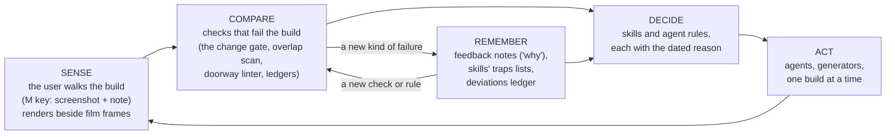

# Every Mistake Becomes a Check

## What rebuilding the Home Alone house with AI agents taught us about working with them

*Draft for the show-and-tell post and talk. The house is the case study; the subject is the working method. Every claim traces to the repo: git history, `docs/`, `.claude/skills/`, `tools/` and the project's feedback memory. Each act opens with screenshots from that stage.*

---

The goal sounds like a weekend toy: walk around the McCallister house from *Home Alone* (1990), in Unity, at true scale, with Kevin kid-sized so he can hide under the beds.

The first rule in the project's agent instructions makes it harder: "Faithfulness is non-negotiable; do not propose 'good enough' geometry."

That rule turned the project into an experiment in working with AI. Agents are fast and confident. "Faithful" is a target no agent can check by looking at its own output. Most of what follows is about closing that gap: how we got from agents saying "done" to a house you can walk through and recognise.

Over ten days that meant 399 commits, each one either a step forward or a new way to catch a step backward.

---

## Act 1: Three houses, none of them right

[[IMG 1]]

[[IMG 2]]

[[IMG 3]]

[[IMG 4]]

It started as a game. In December 2025, Codex scaffolded a multiplayer Godot prototype: spawning, a HUD, a "trap house". The house was an afterthought. By September 2026 the house was the point, and there were three of them:

- a procedural blockout generated from a script, whose own README calls it "a movie-inspired layout study with estimated dimensions";
- a model downloaded from the internet, with no licence file;
- an interior generated from Marina Coates's CG tour of the house on YouTube.

Each one passed its checks: the player could walk every route, and nothing fell through the floor. None of them looked like the house (the user's note from the time: a free-standing fridge, an unfinished upstairs). Every check compared the model with the model; none compared it with the house.

On Sep 11 the project moved to Unity, with one priority order: a faithful house first, gameplay last.

---

## Act 2: When the fixes keep failing, the premise is wrong

[[IMG 5]]

[[IMG 6]]

September was spent measuring rooms by hand-picking points in individual video frames: a door corner here, a bedpost there. Buzz's bedroom became the test case, and every fit failed in a new way. Points near the wall were close, and points further away were badly off. More careful picking didn't help.

We stopped fixing and asked what every failed attempt had in common: they all assumed you can recover a room's depth from a few points in one flat picture. The experiment log puts it plainly: "Every failed Buzz fit assumed proportions could be recovered from hand-picked landmarks in a few frames."

Checked against Marina's floor plan, almost none of the old model's rooms passed. The user's first walk note on it said the living room's shape felt right and the lighting too dark: an early hint that the human eye would be a better instrument than our numbers. The change gate (Act 4) later made the lesson mechanical: after two failed attempts on the same room, it refuses a third until someone writes down why the premise still holds.

---

## Act 3: The ingenious part, rebuilding 3D from a YouTube video

[[IMG 7]]

[[IMG 8]]

[[IMG 9]]

[[IMG 10]]

On Oct 12 the premise changed. Marina's tour is about 38 minutes of a camera gliding through a detailed, unchanging virtual house. That is exactly the input for **structure-from-motion** (SfM): software that watches ordinary video, works out where the camera was in every frame, and rebuilds the 3D shape of what it saw. It's the same idea photogrammetry apps use to turn phone photos into 3D models.

The first run looked like a triumph, with tiny error numbers. A review the same day showed those numbers could stay tiny while the geometry moved a lot: the metric measured self-agreement, not correctness.

So we built a fake house in Unity with known measurements, filmed it the way Marina filmed hers, and scored the tools against the truth. Two reconstruction methods were right in different places, and **when they disagreed, they were usually wrong**. That gave us a test for real footage, where no truth exists: measure each room by both methods and keep only what they agree on.

Real footage then found a failure we wouldn't have guessed: the tool joined the two videos and put the upstairs hall *below* the foyer. The repeating damask wallpaper made two different walls look identical, and a "Living Room" title card matched a "Hall Bathroom" caption in the same font. The fix wasn't better matching but a sanity check, "upstairs must be above downstairs", run before any result is used.

Scale came from each room's door at the standard 80 inches, checked against a ruler of a different kind: the floor areas Marina states in her video. They agreed.

---

## Act 4: The grey-box, and the birth of the gate

[[IMG 11]]

[[IMG 12]]

On Oct 13 the measurements became a building. One script reconciles the measurements into a single spec file, and one generator builds the Unity house from that file and nothing else. The first result was a "grey-box": untextured walls you can walk through.

The user walked it with a tool built that day: press **M** anywhere to save a screenshot, the exact position and a rating, "shape feels right/wrong" and "lighting right/wrong". This made the human the sensor. Agents can't tell whether a room *feels* too narrow, and the user can, in seconds, from the inside.

Then came the day that shaped the rest of the project. An agent resized Buzz's room and declared it verified, because Marina's cameras now sat neatly inside the new walls. But those camera positions came out of the same reconstruction as the new size, so they couldn't have disagreed. It was circular evidence. Four attempts on that premise had already failed, and the result looked broken. The user called it "terrible".

The next day brought more: a ceiling height measured in two rooms applied to all of them, two photos scaled by the same door counted as independent, a step count from an AI summary built without counting. The user wrote:

> "find ways to deterministically prevent yourself from making the same mistakes."

The answer was not a promise to be more careful. It was a **gate**:

- Every geometry change starts with a small record: the claim, the data it rests on, and the ruler that set the scale.
- `change_gate.py` refuses it unless one agreeing check **shares no data, no scale and no upstream** with the claim. Summaries, standard sizes and recollections are leads, never evidence.
- A git pre-commit hook enforces it, like a failing test in CI.

Alongside the gate came the **deviations ledger**. Wherever the build departs from measurement, the departure goes in `docs/DEVIATIONS.md` with its size, the reason, and how to revisit it. By Oct 21 it had 126 entries. Conflicting sources are never averaged: a value halfway between two sources matches neither of them.

---

## Interlude: The film as ground truth

[[IMG 26]]

[[IMG 27]]

[[IMG 28]]

[[IMG 29]]

Marina's tour tells you where the walls are. It can't tell you what the house looked like in 1990. For that we went to the film itself: a folder of 12,611 numbered stills from a public screencap site, one about every half-second of the movie. They live in `0-homealone/full/`, are gitignored and never committed, because the repo is public.

A pile of screenshots became a source of truth through a decision about authority. On Oct 15, for the outside: *"the outside needs to look the same as the movie."* On Oct 18, for everything: the film first, Marina's tour for whatever the film never shows. That ended a recurring agent question ("film or tour?"): the rule answers it, and any blend gets logged.

In practice, "the film is the authority" means four habits:

- **Every claim cites a frame.** Fixes, walk notes and change records name frame numbers: 6399 for the front of the house, 11581 for the Murphys' porch at night with the police cars, 1888 for Marley's turret, 11908 and 12030 for the walk piers and the mailbox, 12511 for the reunion seen through a window. If a claim has no frame, it's a guess, and it gets called one.
- **We stand where the film's camera stood.** From known points on our facade marked in a frame, a script works out where the 1990 camera was and what lens it had (`exterior_film_fit.py`, `nb_film1888_camera.py`). We render our house through that camera and lay it over the frame, so a wrong roof height shows up as a visible misfit.
- **Colours are sampled, not chosen.** Marley's pale rose walls, the kitchen tile and the foyer wallpaper come from measured pixels in specific frames.
- **Review means film beside ours:** the frame, our render from the solved camera, and an overlay.

[[IMG 30]]

Two guardrails keep the film honest. A layout claim (which way a stair turns, where a room's parts sit) must be seen directly in at least two frames that show the part where the options differ. And when no frame exists, the right answer is "not seen". The concrete-slab overclaim in Act 7 is what happens otherwise.

---

## Act 5: Room by room, with the human as the sensor

[[IMG 13]]

[[IMG 14]]

[[IMG 15]]

[[IMG 16]]

The grey-box measured right and felt wrong. The foyer felt like a long corridor. The user's "feels off" note led to the cause: Marina's overhead floor plans are angled renders, and we had traced the walls at their tops. A two-storey wall's top shows up displaced compared with the one-storey walls the calibration used, and that made the **foyer 1.6 m too long**. Measuring from a single in-room frame instead fixed it, and a rule went into the `overhead-floor` skill: check any traced length against something at floor level before trusting it.

With the film as the authority, the red damask wallpaper was cut from a film still, and the lantern was placed where the film shows it. The kitchen cabinets were generated to the measured walls, with tile matched to the film. The user's reaction: *"This is... EXCELLENT! REALLY WELL DONE!"*

Every walk produced notes. Every class of note that kept coming back produced a check:

- **Flicker.** Two surfaces in exactly the same place shimmer as you move, because the screen can't decide which to draw. After three walks in a row of it, the user asked: *"is this something that can be done deterministically with a skill or hook?"* Now the build fails on any overlap: a regression test for a visual bug.
- **Furniture facing the wall.** "you seem to be always rotating furniture 180 degrees the wrong way". A heuristic guessed each piece's back from where its detail clustered, and the carved fronts won. Fixed at the root; a preflight script lists any facing that's still a guess.
- **The chair 18 m outside the house.** On Oct 19 a small turn of the den's armchair threw it 18 m into the yard. The walk test printed a new warning, which was waved off, and a live "move" reported success while changing nothing on screen. Now: render the built result before saying "done", treat a new warning as a failure, and make generators assert every piece stays in its box.
- **The tile across the doorway.** The hall bathroom's tile ran across its own door, past every check. Now rays are cast through every doorway and window, and anything in the way fails the build: a linter for doorways.
- **The lost note.** A note about a window fell through the cracks. Now every note gets a status in a ledger, and open ones are listed at every session start.

We also learned that **one builder at a time** is a law. With several agents in one working tree, a mid-build edit broke a build, and a capture script added a camera to hundreds of objects and froze the user's editor. Now parallel agents only research and prepare, and one agent builds.

---

## Act 6: The levers, building tools instead of repeating inference

A prop job (placing a trunk, say) was taking over half an hour, mostly agent steps and full rebuilds of the house. The user asked, reasonably, whether a trunk really needed that. We broke down where the time went and built the lever: `props.py`, which drops a model into the open editor live, renders its front, and writes the placement back to the spec. Props went from a job to a command.

That became a standing principle in the user's words:

> "a one-time increase in tokens to build the tooling for qa beats repeated inference tasks for verification."

Any check an agent would re-judge by eye each time becomes a script, ideally a ratchet: old problems become a baseline, and anything new fails. `slow_jobs.py` runs at session start and flags any kind of work that keeps running slow, so the next step is a tool, not another agent. Even the user's side got a lever: comparison sheets that opened one by one became a single test board.

---

## Act 7: The outside has to be the movie

[[IMG 17]]

[[IMG 18]]

[[IMG 19]]

[[IMG 20]]

The outside started as a flat snow plane, then the old model's yard with simplified boxes for neighbours. The real problem was that the house doesn't fit together. The film's exterior is the real house in Winnetka, but its upstairs interior was a bigger studio set, and Marina's upstairs follows the set. No single building satisfies both.

The user's ruling (the outside must look like the movie) settled it, so the house is deliberately impossible: from outside you see the film's house; upstairs you're in Marina's bigger rooms, swapped in when you climb the stairs. Every seam got its own check: a doorway flickering between the two worlds, upstairs skirting boards visible floating outside the film's walls, upstairs brick that looked different (now a colour difference with a threshold).

The solved film cameras (see the interlude) gave the house's proportions, and even the sun's position, from the shadow under the front portico.

The honest part: not every mistake became a gate. The coordinator once told an agent that the film shows a "smooth slab concrete" front walk. The user asked, *"where did you find a clear shot of smooth concrete slabs? can you point them out by outlining them in an image?"* There wasn't one; the read came from thumbnails. A "sunroom extension" was built from an index note and had to come out. The rule that covers both is old by now: say "likely" until you've looked.

---

## Act 8: The neighbourhood, from laser maps and the county

[[IMG 21]]

[[IMG 22]]

The street used the house's method, and the evidence is surprisingly public. The county publishes property boundaries and building footprints. The state publishes **LiDAR**, laser height maps flown from aircraft, showing every tree and roof height. Film frames show the neighbours in 1990. Marley's house next door has a turret with a tall cone in the film, and the laser map shows a peak over that corner of its footprint: two rulers of different kinds agreeing.

The LiDAR had a quiet bug: every tree came out about 45 m off, because the server returned a larger map than requested. The giveaway needed no extra data: footprints should sit on rooftops, and these sat on bare ground.

A different kind of mistake also happened here: a communication one. An agent asked which side Marley's house was on, and the coordinator passed the question to the user three times overnight. The user had already answered it: *"why did you do that? i already told you last night he was the left neighbor"*. Now every agent question is checked against what the human has already said before it is relayed.

---

## Act 9: Speed, measured instead of guessed

[[IMG 23]]

Performance followed the same discipline: a floor of 30 frames per second everywhere, and a rule that every lighting or speed change ships with a side-by-side sheet, same views with and without the change, speed printed on every tile. In the user's words: *"I want you to always do this sort of thing when making changes to shadows and lighting so we can have a visual comparison to make tradeoffs."* The user weighs the look against the speed; the agent doesn't decide alone.

At 5K, the obvious fix (render fewer pixels and scale up) made things *slower*. Instead of trying more settings, we read the timings: the graphics driver stalled whenever the resolution changed on the fly. Then, at night, fitting each lamp's light to its own room took the foyer from **23 to 36 frames per second**, and the side-by-side sheet showed the look unchanged. The user's verdict: "was great, keep it."

---

## Today

[[IMG 24]]

[[IMG 25]]

Ten days after the reset: the house from the film outside, Marina's rooms inside, the Murphys' house across the street with police lights flashing, and snow on the walk. You can walk it end to end. What's left is listed in the docs: the open walk notes, some lighting, the front-yard trees, and then the game itself.

---

## The loop

Looking back, the method is a feedback loop, and every part of it is a file in the repo:

The step that closes the loop is that **a failure becomes a check, not a promise**, and the check is proven to catch the old bug before its "all clear" is trusted.

| What went wrong | What we built so it can't happen again |
|---|---|
| Three houses passed their own tests and none was the house | Checks against outside evidence: film, Marina's tour, the real house |
| Hand-picked measurements kept failing in new ways | "Attack the premise": after two failures, test the shared assumption |
| A reconstruction looked perfect by its own error metric and was wrong | A fake house with known answers; two methods must agree |
| Identical wallpaper glued two floors together upside down | A physical sanity check before any result is used |
| A room "verified" by evidence that came from the same data | The change gate: one agreeing check must share nothing with the claim; enforced at commit |
| One measurement copied to rooms it was never taken in | Every measurement says where it applies; departures go in a ledger |
| The foyer was 1.6 m too long because of a drawing's perspective | A rule: check traced lengths against something on the floor |
| Shimmering surfaces, three walks in a row | An overlap scan that fails the build |
| Furniture kept facing the wall | Root-cause fix, plus a preflight list of guessed facings |
| A chair thrown 18 m outside; a warning waved off | Render the built result; a new warning is a failure; pieces must stay in their box |
| Tile across a doorway | A doorway linter that casts rays through every opening |
| A walk note was lost | A note ledger with a status for every note, listed every session |
| Parallel agents broke a build; a capture froze the editor | One builder at a time; captures never modify the scene |
| Slow, repetitive agent jobs | Tools instead (`props.py`, `slow_jobs.py`, practice ratchets) |
| Claims from thumbnails; questions already answered | "Say likely until you've looked"; check questions against the human's earlier answers |

---

## Principles, and the stories that taught them

**Decide who the authority is, and make every claim cite it.** "Film first, Marina fallback" ended a whole class of agent questions, and a frame number on every claim made each one checkable. No frame means "not seen".

**Be ambitious about the target, humble about the evidence.** "Faithful" is an unreasonable goal, and it forced every principle below.

**A model that agrees with itself has proved nothing.** Three September houses passed their own tests; SfM's error numbers looked perfect while the geometry was off. Proof needs a ruler from outside.

**Attack the premise.** After two failed fixes, stop. The Buzz room failures all shared one assumption, and the way forward was to replace it, not refine it.

**Test against known truth first.** The fake house told us where each method fails before we relied on them, and gave us "do two methods agree?" as a test for the real footage.

**No unproven claims.** Make claims machine-checkable and refuse them until they pass. Independence is about the kind of ruler. "Verified" is a word the gate says, not the agent.

**Encode lessons in structure.** Each rule in the project's agent instructions carries the date of the failure that produced it. A rule with its story survives the next context window; "be careful" doesn't.

**Build the lever.** When a job repeats, spend tokens once on a tool rather than every time on inference. Props went from half an hour to a command.

**Make the human the sensor.** People beat any metric at "this feels wrong". Give them a one-key instrument, a ledger and one board.

**Look at the real artifact.** The chair was 18 m outside while every report said success. Render what was built, from the user's own viewpoint, before saying "done".

**One builder at a time.** Parallel agents research well and share a working tree badly.

**Explain the number.** The 5K slowdown wasn't pixels. Reading the timings found the stall that more settings never would have.

**Filter what you relay.** Agents will confidently re-ask settled questions. Check them against what the human already said.

---

## Images

All extracted files are in `~/.cache/home-alone-board/blog-img/` (not in the repo). File-name dates are git commit dates. The Godot-era screenshots (IMG 1-4) were captured by Sep 11, 2026 (per the Godot hand-off docs) and first committed in the Oct 12 snapshot. IMG 7-10 come from `sfm-work/` (gitignored) and are dated by file date.

| Marker | Path | WxH | Caption (date) | Where |
|---|---|---|---|---|
| IMG 1 | /Users/dlo/.cache/home-alone-board/blog-img/2026-10-12-walkthrough.png | 1280x720 | The Godot procedural blockout walkthrough: estimated dimensions, flat colours (by Sep 11) | Act 1 |
| IMG 2 | /Users/dlo/.cache/home-alone-board/blog-img/2026-10-12-exterior.png | 1400x1000 | "Blockout 01": a movie-inspired layout study, not a measurement (by Sep 11) | Act 1 |
| IMG 3 | /Users/dlo/.cache/home-alone-board/blog-img/2026-10-12-online_kitchen_walkthrough.png | 1280x720 | The downloaded model of the house, walked in Godot (by Sep 11) | Act 1 |
| IMG 4 | /Users/dlo/.cache/home-alone-board/blog-img/2026-10-12-marina_godot-kitchen.png | 1280x720 | The first interior generated from Marina's tour: it passed every check (Sep 11) | Act 1 |
| IMG 5 | /Users/dlo/.cache/home-alone-board/blog-img/2026-10-12-references_reconciliation_01-floor-overlays.png | 1700x1050 | "Where the floor plans disagree": three plans that won't line up (September work, committed Oct 12) | Act 2 |
| IMG 6 | /Users/dlo/.cache/home-alone-board/blog-img/2026-10-13-spec_feedback_shots_20261013-161244-IntactHouseReference.png | 2560x1440 | The first walk note, on the old model in Unity: "shape right, lighting too dark" (Oct 13) | Act 2 |
| IMG 7 | /Users/dlo/.cache/home-alone-board/blog-img/2026-10-12-sfm_buzz-hall_topdown-annotated.png | 1062x889 | The first real reconstruction: Buzz's room and the upper hall rebuilt from the tour video, seen from above (Oct 12) | Act 3 |
| IMG 8 | /Users/dlo/.cache/home-alone-board/blog-img/2026-10-12-sfm_synthetic_render_r00309.png | 1920x1080 | The fake house with known answers, used to test the tools (Oct 12) | Act 3 |
| IMG 9 | /Users/dlo/.cache/home-alone-board/blog-img/2026-10-12-sfm_link_m-check.jpg | 1920x1080 | Fooled by wallpaper: a title card matched to a caption, damask matched to damask (Oct 12) | Act 3 |
| IMG 10 | /Users/dlo/.cache/home-alone-board/blog-img/2026-10-12-sfm_parents_plan-0.05.png | 926x543 | Points become a floor plan: the parents' suite, walls in red, camera path in blue (Oct 12) | Act 3 |
| IMG 11 | /Users/dlo/.cache/home-alone-board/blog-img/2026-10-13-oblique.png | 1600x1600 | The first grey-box, generated from the spec file (Oct 13) | Act 4 |
| IMG 12 | /Users/dlo/.cache/home-alone-board/blog-img/2026-10-14-spec_feedback_shots_20261014-150936-Greybox_Upstairs.png | 2560x1440 | A walk note from inside the grey-box, Buzz's room (Oct 14) | Act 4 |
| IMG 13 | /Users/dlo/.cache/home-alone-board/blog-img/2026-10-15-foyer-length_compare.jpg | 1920x806 | The foyer before / Marina's tour / after: 1.6 m too long, then fixed (Oct 15) | Act 5 |
| IMG 14 | /Users/dlo/.cache/home-alone-board/blog-img/2026-10-15-views_hifi-foyer_light-front.png | 1920x1080 | The first foyer dressed from the film: wallpaper cut from a still (Oct 15) | Act 5 |
| IMG 15 | /Users/dlo/.cache/home-alone-board/blog-img/2026-10-17-views_kitchen_after-cab-fridge.png | 1920x1080 | The kitchen's first dressed pass (Oct 17) | Act 5 |
| IMG 16 | /Users/dlo/.cache/home-alone-board/blog-img/2026-10-20-views_bathnotes2_compare-hall-doorway-note0649.jpg | 1920x540 | Tile across the doorway, and after the doorway linter (Oct 20) | Act 5 |
| IMG 17 | /Users/dlo/.cache/home-alone-board/blog-img/2026-10-16-views_outside_front-yard.png | 1920x1080 | Outside on Oct 16: the old model's yard and box neighbours | Act 7 |
| IMG 18 | /Users/dlo/.cache/home-alone-board/blog-img/2026-10-18-views_exterior_after_aerial_front.png | 1920x1080 | The film's house wrapped around the measured ground floor, first trial (Oct 18) | Act 7 |
| IMG 19 | /Users/dlo/.cache/home-alone-board/blog-img/2026-10-19-views_front-drive_after_f11908_night.jpg | 1920x1080 | Front walk and lights at night, seen from where a film camera stood (Oct 19) | Act 7 |
| IMG 20 | /Users/dlo/.cache/home-alone-board/blog-img/2026-10-20-perf_house-split-sheet.jpg | 1920x2940 | The impossible-house seam: an upstairs doorway before and after its check (Oct 20) | Act 7 |
| IMG 21 | /Users/dlo/.cache/home-alone-board/blog-img/2026-10-19-neighborhood_plan-step1.png | 1600x850 | The neighbourhood from county records: lots by tier, building footprints (Oct 19) | Act 8 |
| IMG 22 | /Users/dlo/.cache/home-alone-board/blog-img/2026-10-20-neighborhood_marley_film1888_compare.jpg | 2100x690 | Marley's turret house: the film frame against our render from the recovered camera (Oct 20) | Act 8 |
| IMG 23 | /Users/dlo/.cache/home-alone-board/blog-img/2026-10-21-perf_fs-nightB-sheet.jpg | 8424x2196 | The night speed sheet: same views, each variant side by side, speed on every tile (Oct 21) | Act 9 |
| IMG 24 | /Users/dlo/.cache/home-alone-board/blog-img/2026-10-19-views_kitchen_fidelity_after_1074.jpg | 1280x720 | The kitchen after the fidelity pass (Oct 19) | Today |
| IMG 25 | /Users/dlo/.cache/home-alone-board/blog-img/2026-10-21-views_front-0645_before-after-sheet.jpg | 1930x2310 | Today: the house from the walk in overcast, sun and night, the Murphys' and the police across the street (Oct 21) | Today |
| IMG 26 | /Users/dlo/.cache/home-alone-board/blog-img/film-6399.jpg | 1920x1058 | FILM 6399: the front of the house, the exterior's main reference (film still, 1990) | Interlude |
| IMG 27 | /Users/dlo/.cache/home-alone-board/blog-img/film-11581.jpg | 1920x1058 | FILM 11581: the Murphys' porch at night with the police cars (film still) | Interlude |
| IMG 28 | /Users/dlo/.cache/home-alone-board/blog-img/film-1888.jpg | 1920x1058 | FILM 1888: our house and Marley's turret house to its left (film still) | Interlude |
| IMG 29 | /Users/dlo/.cache/home-alone-board/blog-img/film-12511.jpg | 1920x1058 | FILM 12511: the reunion seen through a window, used to settle which side Marley lives on (film still) | Interlude |
| IMG 30 | /Users/dlo/.cache/home-alone-board/blog-img/2026-10-20-neighborhood_murphys_film11581_compare.jpg | 2900x569 | Film / ours / overlay: the Murphys' house rendered through film 11581's solved camera (Oct 20) | Interlude, review format |

Rights: IMG 9 and 13 show Marina's CG frames, IMG 22 and IMG 30 include film frames, and IMG 26-29 are film stills (screencaps, gitignored in the repo). The page is private; check before any public post. Spare extracted images in the same folder: `2026-10-12-sfm_buzz-door-measure.jpg`, `2026-10-13-sfm_parents_plan-reviewed.png`, `2026-10-16-views_outside_street.png`, `2026-10-18-views_exterior-realism_after_film4382.jpg`, `2026-10-19-views_sun-sky_after_sunny_street.jpg`, `2026-10-20-views_exterior-shrubs-scan_after_film4382.jpg`, `2026-10-20-perf_nb-old-new-sheet.jpg`, `2026-10-17-views_den_after-f153-night.png`.
